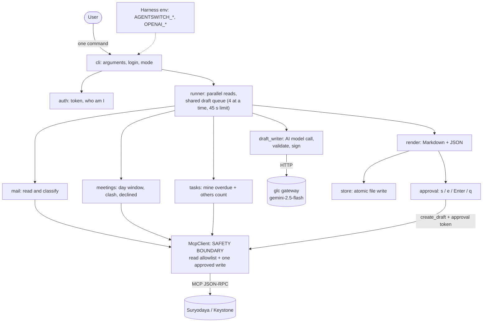
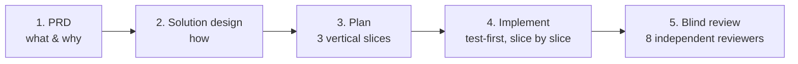

# Seat 28 EA: Daily Briefing (Sandip): Work Summary

> **One command** reads mail, today's meetings and my overdue tasks from **Suryodaya** and **Keystone**. It prints and saves one dated briefing, and it proposes a reply for each mail that needs an answer, written by an AI model through the **glc** gateway. A reply becomes an unsent draft only after I approve it, one reply at a time. **Nothing is ever sent, booked or changed on its own.**

| | |
|---|---|
| **Code** | `28-ea/sandip/` on branch [`seat28/sandip-daily-briefing`](https://github.com/sandip-jadhav/agentswitch-advanced-28-mail/tree/seat28/sandip-daily-briefing) |
| **Stack** | Python 3.9+, standard library only (no pip installs) |
| **Status** | All 3 planned slices built and checked live on both systems |
| **Tests** | 680 offline unit and scenario tests, all passing in under 1 second |
| **AI model** | `gemini-2.5-flash` through the local **glc** gateway (`http://127.0.0.1:8111/v1`) |

---

## 1. What it does

```
python3 28-ea/sandip/briefing.py login keystone     # once per system, every 7 days
python3 28-ea/sandip/briefing.py                    # the daily briefing, both systems
python3 28-ea/sandip/briefing.py --system keystone --json result.json
```

Each system gets its own section with three parts:

| Part | What you see |
|---|---|
| **Mail** | Unread inbox mail that needs an answer, oldest first: sender, subject, time, a one-line English summary and a **proposed reply**. Mail that needs no reply (no-reply senders, newsletters, automated mail, your own mail) is listed under "Skipped" with the reason. |
| **Meetings** | Today's meetings in **that system's own time zone** (Suryodaya: Asia/Kolkata, Keystone: America/New_York), marked **clash** and **declined** where they apply. |
| **Tasks** | **My own** overdue tasks, most overdue first, plus a count of everyone else's. |

The briefing ends with a status line that names every part as complete or missing, and the time the run took. Then comes the **approval step**: for each proposed reply you choose `s` save, `e` edit then save, `Enter` skip or `q` stop.

---

## 2. Architecture



**A run has five stages:**

1. **Setup.** Parse the arguments, pick local or harness mode, load each system's token, and ask `/api/auth/me` who the user is.
2. **Fetch in parallel.** One thread per part per system, up to 6. Each part returns its data or a plain failure reason, so **one broken part never stops the rest**.
3. **Draft.** As soon as a system's mail is read, its messages join a queue shared by both systems, oldest first. At most 4 model calls run at a time, and drafting stops 45 s after the run starts, so a run stays under about 60 s.
4. **Render and save.** One Markdown text goes to the screen and to `briefings/<date>.md`, written atomically (a temporary file, then a rename).
5. **Approve.** Each proposed reply is offered for a decision. Approved ones are saved as unsent drafts.

---

## 3. Code structure

```
28-ea/sandip/
├── briefing.py            # entry point → ea_briefing.cli.main()
├── ea_briefing/
│   ├── cli.py             # arguments (--system, --tz, --json, login), wiring, exit codes 0/1/2
│   ├── config.py          # system table, time zones, harness-mode checks, model settings
│   ├── auth.py            # login (hidden password prompt), token file (0600), /api/auth/me
│   ├── mcp.py             # McpClient: JSON-RPC over urllib, paging, typed errors, WRITE GUARD
│   ├── runner.py          # timer, part threads, shared drafting queue, 45 s deadline
│   ├── mail.py            # mailbox check, unread fetch, skip rules, existing-draft lookup
│   ├── draft_writer.py    # AI model adapter (glc), prompt, response validation, signature
│   ├── meetings.py        # day window per zone, overlap, clash and declined marks
│   ├── tasks.py           # own overdue tasks, others count
│   ├── render.py          # pure functions: results → Markdown and JSON (no I/O)
│   ├── store.py           # file naming, nothing-fetched rule, token redaction, atomic write
│   └── approval.py        # s/e/Enter/q loop, re-check before save, read-back after save
├── tools/snapshot.py      # guardrail: before/after snapshot of record ids, then a diff
├── tests/                 # 14 test files, fake transport, fake clock, fake model, fixtures
├── docs/sdlc/changes/2026-11-05-daily-briefing/   # PRD, design, plan, review, retro
├── README.md              # setup, run, settings, harness mode, safety rules, live findings
└── SUMMARY.md             # this summary
```

**Design rules:** small modules that can each be tested alone, the standard library only, and every network call behind a seam that tests can replace with a fake.

---

## 4. How the AI model is used (glc)

The platform has no text-generation tool, so the briefing calls a model **outside** the platform: the local **glc** gateway running **`gemini-2.5-flash`**.

**What the model does:** for each message that needs an answer, one call returns JSON:

```json
{ "summary": "...", "summary_language": "en", "needs_decision": false,
  "message_language": "en", "reply_language": "en", "greeting": "...", "body": "..." }
```

**What the model never does:**

- **It never decides which mail is shown.** Fixed rules on headers and flags pick the mail before any model call, so the model cannot hide a message or invent one.
- **It never sends or saves anything.** Its reply is text in the briefing until I approve it.

**What the code checks in every reply:**

| Check | If it fails |
|---|---|
| The greeting is not empty | No draft, and the message says "reply by hand" |
| The reply is at most 120 words | No draft, and the message says "reply by hand" |
| The reply is in the same language as the mail | No draft, and the message says "reply by hand" |
| The summary is in English | The message's first line is shown instead |
| The signature is added by code, not by the model | n/a |
| A keyword rule (date, payment, invoice, attend, meeting…) can add **"needs your decision"**, and the model can never remove it | The reply is requested again with "do not agree to any date, amount or attendance" |

**Protection against tricks hidden in mail (prompt injection):** the mail body goes to the model as quoted data, with an instruction to ignore any instructions inside it. The worst a tricky email can cause is a bad proposal, which I see and can skip.

**What the live probe found about glc:** glc is **not** OpenAI-compatible. `/v1/chat/completions` answers 404. glc's own `POST /v1/chat` takes `{model, system, messages, max_tokens, temperature}` and answers `{text}`, it drops `system`-role messages, and it answers 503 to calls made in quick succession. So the adapter:

- tries `chat/completions` first, for the harness's gateway, then switches to glc's `/chat` on a 404;
- puts the system prompt in glc's `system` field;
- waits 3 s and retries up to 3 times on a 429 or 503, never past the 45 s limit;
- times out each call after 15 s, and skips the model for the rest of the run if it can't connect ("model unavailable").

**Configuration:**

```
OPENAI_BASE_URL=http://127.0.0.1:8111/v1  OPENAI_MODEL=gemini-2.5-flash   # glc, no key needed
```

Under the Eval Harness the same variables point at the harness's own gateway, and `OPENAI_API_KEY` is sent and redacted as a secret.

---

## 5. Safety: "nothing changes without approval" is enforced in code

- **Write guard.** `McpClient` refuses, **before any network call**, every tool outside a fixed read allowlist. `EmailMessage.reply`, `send_email`, `Task.update` and the rest cannot be called.
- **The one write.** `create_draft` needs a **single-use approval token** that only the approval loop mints, plus `folder="drafts"` and `is_draft=true`.
- **No sends.** A save is an unsent draft. The original mail is re-read just before saving ("already answered?") and the new draft is read back just after.
- **No secrets in output.** Tokens and the model API key are replaced by `***` on screen, in the Markdown and in the JSON.
- **No private data in git.** `briefings/` and `snapshots/` are git-ignored.
- **Guardrail check.** `tools/snapshot.py before/after/diff` showed **"No differences"** after a run that skipped every reply, and **exactly 3 new drafts** after I approved 3 replies.

---

## 6. How the work was done

The work followed a **phased, spec-driven process with an AI coding assistant (Claude Code)**. Each phase produced a reviewed document before any code was written:



| Step | What happened |
|---|---|
| **Requirements (PRD)** | 5 user stories with acceptance scenarios, functional and non-functional requirements (for example, the 60 s limit and no writes without approval) |
| **Design** | Architecture, components, data flow, 19 recorded decisions with their reasons, and every deviation from the PRD written down and approved |
| **Plan** | The program design cut into 3 slices, each one usable on its own |
| **Live probes** | Read-only calls to both live systems **before** each slice, to check field names, filters and the glc API instead of guessing |
| **Implement** | Test-first (TDD): each behaviour became a failing test before the code. Slice 1: meetings and tasks. Slice 2: mail and AI replies. Slice 3: approve into the mailbox |
| **Blind review** | 8 AI reviewers (correctness, contracts, design, security, performance, testability, conventions, docs), **not told what the change was for**, so they judged the code alone |

**Slices delivered:**

| Slice | Delivers | Live check |
|---|---|---|
| 1 | Two-system briefing: meetings (zones, clash, declined), own overdue tasks, partial-failure handling, exit codes, harness mode, `--json` | 3 runs: 11.7 s, 12.2 s, 12.6 s |
| 2 | Mail that needs an answer, skip rules, AI summary and reply via glc, 45 s drafting limit | 3 runs with glc: 28.6 s, 27.1 s, 30.3 s |
| 3 | Approval loop: save, edit, skip, stop; unsent drafts with re-check and read-back | 3 drafts saved on Keystone; a rerun shows "draft already saved" |

---

## 7. Assumptions and what the live probes changed

| Assumption | Result |
|---|---|
| glc is OpenAI-compatible | ❌ **Refuted.** Adapter added with a fallback to glc's own `/v1/chat` |
| Event times are stored in UTC | ❌ **Refuted.** They are local wall-clock time in the row's zone. Fixed |
| Server date filters compare dates | ❌ **Refuted.** They compare the stored text, so the fetch uses a wide date-only window and the client decides the overlap |
| An all-day event's end date is inclusive | ❌ **Refuted.** It is exclusive. Fixed |
| `assignee_id` holds the user id | ❌ **Refuted.** It holds an Employee id (empty for this login), so own tasks also match on `created_by` |
| `EmailMessage.get` doesn't mark mail read | ✅ Confirmed (snapshot diff) |
| A created draft doesn't change the original | ✅ Confirmed (snapshot diff) |
| `EmailMessage.create` makes a threaded, unsent draft | ✅ Confirmed (read back: `folder=drafts`, `in_reply_to` set, thread kept) |
| Using a model on mail content is allowed | ⚠️ Open question for the course team. If not, replies would need templates and the replies-in-the-mail's-language requirement would change |

**Other working assumptions:**

- "Today" means each system's own calendar day.
- The file is named by the date on my machine.
- Declined meetings still count for clashes (read literally from the requirement).
- A very slow platform can push a run past 60 s, because long lists are always shown in full.

---

## 8. Documentation created

| Document | Contents |
|---|---|
| [`README.md`](README.md) | Login, run, settings, approval keys, harness mode, tests, safety rules, live-probe findings, timing record |
| [`prd.md`](docs/sdlc/changes/2026-11-05-daily-briefing/prd.md) | Requirements: 5 user stories with scenarios, FR/NFR, success metrics, out of scope, decisions |
| [`solution-design.md`](docs/sdlc/changes/2026-11-05-daily-briefing/solution-design.md) | Architecture, components, data flow, error handling, testing, decisions SD-D-1…19, deviations |
| [`plan.md`](docs/sdlc/changes/2026-11-05-daily-briefing/plan.md) | Program design, 48 behaviours, 3 slices with tasks, probe and live evidence, replan log |
| [`review-1.md`](docs/sdlc/changes/2026-11-05-daily-briefing/review-1.md) | The blind review: coverage, findings, what needs human judgement |
| [`implement-retro.md`](docs/sdlc/changes/2026-11-05-daily-briefing/implement-retro.md) | Retrospective of the implementation phase |

---

## 9. Testing and review results

- **680 tests, all passing offline in under 1 s:**

  ```
  python3 -m unittest discover -s 28-ea/sandip/tests -t 28-ea/sandip
  ```

  They use a fake transport that records every call, a fake clock, a fake model server and fixtures. `test_scenarios.py` runs the whole command once for each PRD scenario.
- **Live runs** on both systems for every slice, with timings in `README.md`.
- **Blind review result:** 0 critical, 0 major, 20 minor findings. Examples:
  - flaky-timing risks in a few tests;
  - small duplicated helpers;
  - plain `http://` endpoints are accepted.
- **Points left for human judgement (from the review):**
  - Should declined meetings still mark clashes?
  - Is 4 parallel model calls right for glc's rate limits?
  - What should the `--json` key `draft_saved` be named before the harness suite depends on it?

---

## 10. Known limits and next steps

- **Suryodaya has no mailbox** for our login yet, so its mail path is checked offline only.
- **Not run live:** edit then save, a refused save, "already answered", an expired login during approval, and Ctrl-C. Unit tests cover them.
- **Model quality** (right language, no hidden commitments) rests on the model plus my review of every draft. Code checks the format, not the meaning.
- **Next (version 1, 30 Nov):** the Eval Harness task suite on top of the `--json` output and exit codes already built.

---

## Commit history

The branch is rebased on the latest upstream `main` and squashed into 3 commits:

```
feat(seat28): add daily briefing agent (ea_briefing package and CLI)
test(seat28): add tests, fakes and fixtures for the daily briefing
docs(seat28): add PRD, solution design, plan, review and retro for the daily briefing
```
