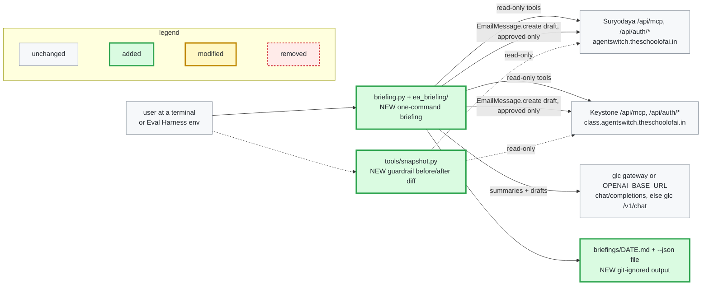
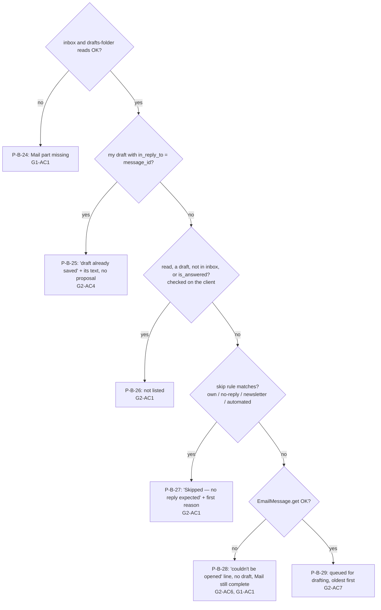

# Plan: Seat 28 EA — Daily Briefing (Sandip)

> **For agentic workers:** REQUIRED PHASE COMMAND: Run the implement phase command with this file's path to execute this plan. It runs one slice per session, and only a slice with tasks. The program design below is binding: build the call trees as drawn, and turn each behaviour into a failing test before you write the code.

**Date:** 2026-11-06
**Artifact:** plan
**Design:** [solution-design.md](solution-design.md)
**PRD:** [prd.md](prd.md)
**References:** Seat brief `28-ea/README.md`; seat 33 client `33-red-team/replay/mcp_client.py` (pattern); `34-eval-harness/TASK_FORMAT.md`
**Strategy:** slices
**Test command:** `python3 -m unittest discover -s 28-ea/sandip/tests -t 28-ea/sandip` (run from the repository root)
**Status:** Approved
**Template version:** default/0.3.2

**Plugin version:** 0.7.5
**Agent Sessions:** claude-code: cc666ea2-06ba-455b-9e65-6fddb31fb2af
**Agent Sessions:** claude-code: ccc387e7-e8a2-47cc-b65b-0f4219fb0e79
**Agent Sessions:** claude-code: a3fc4dee-13ba-4e04-b365-41a963eb6b2d
**Agent Sessions:** claude-code: 01428c8a-1ca8-4bc7-9313-bbe4d328e401
**Agent Sessions:** claude-code: 280d9e28-3b1a-48f2-8fc3-dd9745c7a0d3
**Agent Sessions:** claude-code: e5b1c722-f76e-4f46-9cd0-d824f993126f
**Agent Sessions:** claude-code: bc261a3e-347e-4f91-8d31-2a10a85cf1a4
**Agent Sessions:** claude-code: a341ba67-5d61-4111-8552-e420bc970ec3

---

## Program design

### R0 — Headline

One command, `python3 28-ea/sandip/briefing.py`, reads mail, today's meetings and the user's own overdue tasks from Suryodaya and Keystone, and prints and saves a dated briefing. Mail that needs an answer gets a proposed reply. Replies are saved as mailbox drafts only after the user approves each one. Nothing is ever sent or changed.

### R1 — The whole flow



Everything on our side is new. The two platforms and the model gateway don't change. The only arrow that writes is the approved draft create. Every other arrow from the briefing is read-only, and the MCP client enforces that ([SD-D-5](solution-design.md#sd-d-5)).

### R2 — Seams — where the change attaches to existing code

No existing code changes. The package copies the request shape of `33-red-team/replay/mcp_client.py`: JSON-RPC `tools/call` POSTed to `<base>/api/mcp`, `Authorization: Bearer`, `Accept: application/json, text/event-stream`, `data:` lines parsed. It adds typed errors and paging, which seat 33 doesn't have.

```diff
  28-ea/sandip/
+   briefing.py               # entry: calls ea_briefing.cli.main() (slice 1)
+   ea_briefing/
+     __init__.py
+     cli.py                  # args (--system, --tz, --json, login), wiring, exit codes 0/1/2 (slice 1); builds draft_writer and the per-system signatures, adds the model API key to secrets, help text names the model variables (slice 2); builds one McpClient per system with proposals, runs approval, then saves the Markdown again with the Approval section and writes the --json file; help text names the one write, approved drafts (slice 3)
+     config.py               # system table + default zones, harness-mode checks, env settings, zone parsing (slice 1); ModelSettings from OPENAI_* or BRIEFING_LLM_*, BRIEFING_SIGNATURE, in both modes (slice 2)
+     auth.py                 # login (getpass, 0600 file), load (harness > env > file), whoami (/api/auth/me) (slice 1); load_signature (env > login file; no file in harness mode) (slice 2)
+     mcp.py                  # McpClient: tools/call, typed errors, list_all paging, read allowlist (slice 1); create_draft + ApprovalToken (slice 3)
+     runner.py               # run timer, part threads (slice 1); shared draft queue owned by run(), 4 workers, 45 s deadline on clock.monotonic(), drafts attached to each MailPart after the joins (slice 2)
+     mail.py                 # mailbox check (slice 1: a mailbox that exists gives Mail missing, "mail listing not built yet"); inbox + drafts reads, skip rules, full reads -> MailPart (slice 2); MailPart keeps the mailbox's id and address for the draft's mailbox_id and from_email (slice 3)
+     draft_writer.py         # prompt, adapter (OpenAI-compatible, else glc /v1/chat after a 404; busy retry) over the same transport callable, validation, keyword rule, signature (slice 2)
+     meetings.py             # day window per zone, overlap, ordering, clash/declined -> MeetingsPart (slice 1)
+     tasks.py                # own overdue + others count -> TasksPart (slice 1)
+     render.py               # pure, never given a secret: results -> Markdown, status line, --json dict (slice 1); mail entries (slice 2); Approval section after the status line, `approval` key in the --json dict (slice 3)
+     store.py                # redact(text, secrets) -> *** for screen and files, file names, nothing-fetched rule, atomic write of Markdown and JSON, save-failure message (slice 1); unchanged in slice 3: a second save() replaces the same file
+     approval.py             # Proposal list from results, s/e/Enter/q loop on stdin, editor, re-check, read-back, summary counts (slice 3)
+   tools/
+     snapshot.py             # guardrail: ids + updated_at per system, diff two snapshots (slice 1)
+   tests/
+     __init__.py             # makes tests importable under -t 28-ea/sandip (slice 1)
+     fakes.py                # FakeTransport (records every call), FakeClock (slice 1); FakeDraftWriter, message_row(), a fake model server (slice 2); FakeEditor, TtyInput (scripted stdin whose isatty() is true), threading fields in message_row(), an EmailMessage.create handler (slice 3)
+     fixtures/               # JSON rows for events, tasks, /api/auth/me (slice 1); messages (slice 2)
+     test_<module>.py        # one unittest suite per module
+     test_scenarios.py       # test_story<N>_scenario<M>_* end to end through cli.main with fakes
+   .gitignore                # briefings/, snapshots/, __pycache__/ (slice 1)
+   README.md                 # login, run, settings, harness mode, tests, safety rules, timing record (slice 1; each later slice adds its part)
    docs/sdlc/changes/2026-11-05-daily-briefing/   # this plan and its design
```

A briefing run, from the entry point:

```text
briefing.py
└── cli.main(argv, env, stdin, clock, transport, getpass_fn, editor=None)   # editor injected by tests (slice 3); the terminal check is stdin.isatty()
    ├── config.resolve(args, env)             # Mode: local or harness; ModelSettings; exit 2 on bad combos
    ├── auth.load(system, mode, env) per system   # token: AGENTSWITCH_TOKEN > AGENTSWITCH_<SYS>_TOKEN > ~/.config/agentswitch/<sys>.json
    ├── signatures = {system: auth.load_signature(system, mode, env)}   # BRIEFING_SIGNATURE > that system's login file; None → whoami name (slice 2)
    ├── secrets = tokens + model API key      # slice 2 adds the key
    ├── draft_writer.DraftWriter(model_settings, transport, clock)   # keeps calls / failures / unreachable counts; no model configured → every write is DraftFailed("model unavailable"), no call (slice 2)
    ├── runner.run(systems, tokens, clock, transport, progress, draft_writer, signatures) -> RunResult(results, elapsed, model)
    │   ├── run(): queue + 4 workers, deadline = start + 45 s (slice 2)
    │   ├── thread per system: _read_system(system, token, clock, transport, fatal, on_mail)
    │   │   ├── auth.whoami()                 # User(id, employee_id, email, name); failure fails all 3 parts
    │   │   ├── thread mail.read(client, user)        -> PartResult[MailPart]
    │   │   │   └── on success: on_mail(system, part.needs_answer)   # queue.add, oldest received_at first (slice 2)
    │   │   ├── thread meetings.read(client, user, zone, clock, naive_zone) -> PartResult[MeetingsPart]
    │   │   └── thread tasks.read(client, user, zone, clock)    -> PartResult[TasksPart]
    │   ├── worker: _guard → draft_writer.write(message, user, signatures[system]) -> Draft | DraftFailed   # takes nothing at or after the deadline; an unexpected error → DraftFailed("model unavailable"), never fatal
    │   └── after all joins: attach Draft / DraftFailed per message to its MailPart; a message never taken → DraftFailed("time limit"); model = draft_writer.stats() (slice 2)
    ├── render.markdown(results, elapsed, day) / render.json_result(results, elapsed, day, model)   # no secrets passed in; status_line inside markdown; model block (slice 2)
    ├── print(store.redact(text, secrets))    # loaded tokens and API key -> ***
    ├── store.save(text, results, dir, day, systems, secrets)   # redacts, skipped when nothing fetched; tmp file + os.replace
    ├── if nothing fetched: no approval step, no second save (P-B-7 unchanged) (slice 3)
    ├── proposals = approval.proposals(results)   # Proposal(system, message, draft, mailbox) for every Draft, oldest first per system (slice 3)
    ├── clients = {name: McpClient(base_url, tokens[name], transport, label)}   # one per system with proposals; the runner's clients don't outlive run() (slice 3)
    ├── approval.run(proposals, clients, stdin, editor, say) -> ApprovalSummary   # mints ApprovalToken per chosen reply; offers, "Saving draft…", "Saved" and the summary go to stderr through say, redacted, so stdout holds only the briefing (P-B-9)
    │   └── McpClient.create_draft(args, token)   # the only write path; call() and READ_TOOLS stay read-only
    ├── store.save(text + render.approval_section(summary), …)   # only when the first save returned "saved"; Approval section after the status line; same file replaced (slice 3)
    └── store.save_json(render.json_result(…, approval=summary), path, secrets)   # JSON written after approval (slice 3)
```

Login, and the single write path:

```text
briefing.py login <system>
└── cli.main → auth.login(system)            # getpass, POST /api/auth/login, signature asked once, file mode 0600

approval.offer(proposal) with choice s or e
├── McpClient.call("EmailMessage.get", original)  # answered → "Already answered — draft not saved"
├── McpClient.create_draft(args, ApprovalToken)   # NEW method (slice 3); folder=drafts, is_draft=true; company_id, mailbox_id, thread_id, references from Message.row, from_email from MailPart's mailbox, as the slice 3 probe finds them
└── McpClient.call("EmailMessage.get", new_id)    # failure → "Draft may not be saved — check your Drafts folder"
```

Data types the reader needs: `PartResult` (data, or a failure with its plain reason), `MailPart`, `MeetingsPart`, `TasksPart`, `User`, `Draft` / `DraftFailed(reason)`, `Proposal`, `ApprovalToken`, `ApprovalSummary` (saved, edited, skipped, not saved, failed saves with their text), and the typed errors `LoginExpired`, `Unreachable` and `ToolFailed(reason)`. The test seam is the `transport` callable that `McpClient`, `auth` and `draft_writer` take (tests inject `FakeTransport`; scenario tests serve a fake model at a third base URL), plus an injected `clock`, `draft_writer`, `stdin` and `editor`. `FakeClock` has no sleep, so the 45 s deadline is read only from `clock.monotonic()`, and tests move it with a fake writer that calls `clock.advance()`.

Look twice at `McpClient`'s allowlist and `create_draft`. Every safety claim rests on them: an unlisted tool raises before the transport is touched.

### R3 — Behaviour

**Briefing run, meetings and tasks**

| P-B-ID | Situation | Result | Proves |
|---|---|---|---|
| <a id="p-b-1"></a>P-B-1 | Full run, both systems read fine | One section per system with Mail, Meetings and Tasks. A status line names each part complete or missing, with elapsed seconds that exclude approval time. The all-complete case needs mail and is [P-B-46](#p-b-46) | [G1-AC1](solution-design.md#g1-ac1) |
| <a id="p-b-2"></a>P-B-2 | Keystone returns 401, from `/api/auth/me` or a tool, or has no token | All three Keystone parts read "Keystone: login expired — log in again". Suryodaya is complete | [G1-AC2](solution-design.md#g1-ac2) |
| <a id="p-b-3"></a>P-B-3 | `/api/auth/me` times out or can't connect; or it fails another way | All three parts of that system show "can't be reached right now — try again later", or "couldn't be read (reason: …) — report it if it repeats" | [G1-AC2](solution-design.md#g1-ac2), [G1-AC3](solution-design.md#g1-ac3) |
| <a id="p-b-4"></a>P-B-4 | Only `CalendarEvent.list` fails (tool error or timeout) | Meetings shows its reason. Mail and Tasks of that system are shown | [G1-AC3](solution-design.md#g1-ac3) |
| <a id="p-b-5"></a>P-B-5 | `--system keystone` | Only Keystone is read and shown, and the status line names only Keystone. It saves `<date>-keystone.md`, and `<date>.md` stays byte-identical | [G1-AC4](solution-design.md#g1-ac4) |
| <a id="p-b-6"></a>P-B-6 | Full rerun the same day | `<date>.md` is replaced. Other dates' files and one-system files are untouched. The date is the machine-local date | [G1-AC4](solution-design.md#g1-ac4), [SD-D-12](solution-design.md#sd-d-12) |
| <a id="p-b-7"></a>P-B-7 | Every requested part is missing, "no mailbox" included | No file is written. An existing file of that name is byte-identical. "Nothing fetched — today's earlier briefing file kept" is shown, and the exit code is 1 | [G1-AC5](solution-design.md#g1-ac5), [G6-AC5](solution-design.md#g6-ac5) |
| <a id="p-b-8"></a>P-B-8 | The briefing folder isn't writable | The briefing is still printed, the earlier file is intact, and the PRD's "Briefing shown but not saved to file: …" message is shown | [G1-AC6](solution-design.md#g1-ac6) |
| <a id="p-b-9"></a>P-B-9 | Any run | "Reading Suryodaya…" and "Reading Keystone…" go to stderr. Stdout and the file hold only the briefing | [G1-AC7](solution-design.md#g1-ac7) |
| <a id="p-b-10"></a>P-B-10 | No mailbox (`Mailbox.list` and `EmailAccount.list` both empty) | Mail shows "<System>: no mailbox for this login — ask the course team to set one up" and counts as missing. No model call is made | [G2-AC5](solution-design.md#g2-ac5) |
| <a id="p-b-11"></a>P-B-11 | Fixed clock; `--tz keystone=<zone>`; an unknown zone | Today is the system's calendar day, Asia/Kolkata or America/New_York by default. An override changes one system. An unknown zone falls back with "Unknown time zone '…' — using IST for Suryodaya" | [G3-AC1](solution-design.md#g3-ac1) |
| <a id="p-b-12"></a>P-B-12 | Events include ones spanning midnight, all-day, cancelled, and one at 22:00 Eastern | Overlapping events are listed, cancelled ones hidden, all-day events first and then by start. Each shows "09:00–09:30 IST"-style times in the system's zone, title, and organiser or "—" | [G3-AC2](solution-design.md#g3-ac2) |
| <a id="p-b-13"></a>P-B-13 | Two timed meetings overlap, one is declined by the user's email, and an all-day event overlaps both | Both overlapping meetings are marked "clash", the declined one included. The declined one is also marked "declined". The all-day event clashes with nothing | [G3-AC3](solution-design.md#g3-ac3) |
| <a id="p-b-14"></a>P-B-14 | The fake server ignores the date filters and returns every event | Same list as with filters: the client-side overlap check decides | [G3-AC4](solution-design.md#g3-ac4) |
| <a id="p-b-15"></a>P-B-15 | Tasks due 1, 5 and 10 days ago, due today, done, no due date, and another user's | Only the user's open past-due tasks (`created_by` = id, or `assignee_id` = id or employee_id) are listed, most overdue first, with title, due date and days overdue | [G4-AC1](solution-design.md#g4-ac1) |
| <a id="p-b-16"></a>P-B-16 | None of the user's tasks are overdue, and 63 other overdue tasks are visible | "No overdue tasks of yours" and "63 other overdue tasks are visible to this login". Empty parts say "Nothing for today" or "No meetings today" | [G1-AC1](solution-design.md#g1-ac1), [G4-AC1](solution-design.md#g4-ac1) |
| <a id="p-b-17"></a>P-B-17 | Own-task reads fail; or only the others read fails, on page 2 of 3 | Own reads failing makes Tasks missing. The others read failing keeps the own list, shows "Count of other overdue tasks unavailable — your own list above is complete", and Tasks stays complete | [G4-AC2](solution-design.md#g4-ac2) |
| <a id="p-b-18"></a>P-B-18 | Code calls `EmailMessage.reply`, `EmailMessage.send_email`, `Task.update`, or `EmailMessage.create` without an approval token | Each raises before the transport. `FakeTransport` records zero calls | [G5-AC1](solution-design.md#g5-ac1) |
| <a id="p-b-19"></a>P-B-19 | A loaded platform token appears in a fake event title or task title | Screen, Markdown and JSON show `***`, applied by `store.redact`. The file is still saved | [G5-AC6](solution-design.md#g5-ac6) |
| <a id="p-b-20"></a>P-B-20 | `briefing.py login keystone` | The password is asked with `getpass` and never stored. The signature name is asked the first time only. `{token, signature}` goes to `~/.config/agentswitch/keystone.json`, mode 0600. `AGENTSWITCH_KEYSTONE_TOKEN` overrides the file | [SD-D-3](solution-design.md#sd-d-3) |
| <a id="p-b-21"></a>P-B-21 | Harness variables: token or instance set without the other two; a bad instance; a `--system` that conflicts with the instance; `AGENTSWITCH_BASE_URL` alone | The run exits 2 with one plain line. `BASE_URL` alone is ignored with a stderr warning. A valid harness run reads only that instance at that URL, and no login file | [G6-AC1](solution-design.md#g6-ac1) |
| <a id="p-b-22"></a>P-B-22 | `--json <path>` | JSON holds each part's `complete` or missing reason, event ids with clash/declined marks, own overdue task ids with days overdue, and the others count | [G6-AC4](solution-design.md#g6-ac4) |
| <a id="p-b-23"></a>P-B-23 | The run completes with gaps; nothing could be fetched; a usage or configuration error | Exit 0, 1 and 2 respectively | [G6-AC5](solution-design.md#g6-ac5) |

**Which mail gets a proposed reply.** The leaves are behaviours [P-B-24](#p-b-24) to [P-B-29](#p-b-29). <a id="p-b-24"></a><a id="p-b-25"></a><a id="p-b-26"></a><a id="p-b-27"></a><a id="p-b-28"></a><a id="p-b-29"></a>Fixed rules, applied in this order before any model call, decide each inbox row's place, and the model never adds or removes one. The server filters `folder="inbox"`, `is_read=false` and `is_draft=false` only narrow the fetch: the slice 1 probe found the server compares stored text, so the client checks all four flags again, and a read, draft or answered row is never listed (PRD Story 2 Scenario 5). They prove [G2-AC1](solution-design.md#g2-ac1), [G2-AC4](solution-design.md#g2-ac4), [G2-AC6](solution-design.md#g2-ac6) and [G1-AC1](solution-design.md#g1-ac1).



**Proposed replies**

| P-B-ID | Situation | Result | Proves |
|---|---|---|---|
| <a id="p-b-30"></a>P-B-30 | The model returns a valid result | Entry shows sender, subject, received time in the system's zone, the English summary, and the reply as greeting + body + signature. The signature is `BRIEFING_SIGNATURE`, else the login name, else `/api/auth/me` `name`. Entries are oldest first | [G2-AC2](solution-design.md#g2-ac2) |
| <a id="p-b-31"></a>P-B-31 | The reply has no greeting, runs over 120 words, or has `reply_language` ≠ `message_language`; or `summary_language` isn't English | A bad reply is dropped: "No draft for this message (…) — reply by hand". A non-English summary is replaced by the first sentence (25 words at most) labelled "(no summary — first line shown)" | [G2-AC2](solution-design.md#g2-ac2) |
| <a id="p-b-32"></a>P-B-32 | The keyword rule matches (date, time, payment, invoice, attend, meeting, confirm, deadline) but the model says no decision | The entry is marked "needs your decision". A second request carries the non-committal instruction. If that redraft is invalid too, it shows "No draft for this message (needs your decision) — reply by hand" | [G2-AC3](solution-design.md#g2-ac3) |
| <a id="p-b-33"></a>P-B-33 | Fake clock, slow fake writer, messages from both systems | Drafting starts once a Mail part is read, takes the oldest `received_at` across systems, and runs at most 4 calls at a time. At 45 s from run start, the rest show their first line and "(time limit)" | [G2-AC7](solution-design.md#g2-ac7) |
| <a id="p-b-34"></a>P-B-34 | The model connection fails, times out (15 s), or returns invalid JSON; or the writer raises an unexpected error | That message shows "(model unavailable)" with its first line, and the run goes on. After a connection failure, the rest of the run skips the model | [G2-AC2](solution-design.md#g2-ac2) |
| <a id="p-b-35"></a>P-B-35 | Drafting runs | "Drafting replies (3 of 7)…" goes to stderr only | [G1-AC7](solution-design.md#g1-ac7) |
| <a id="p-b-36"></a>P-B-36 | `OPENAI_BASE_URL` set with or without `OPENAI_MODEL` or `OPENAI_API_KEY`; or unset | The request goes to `<OPENAI_BASE_URL>/chat/completions` with the model (exit 2 if the model is missing) and a Bearer key when given; on a 404 it goes to `<url>/chat` (glc's own API, prompt in its `system` field) for the rest of the run, and if that also answers 404 it stays on `chat/completions` alone (deviation row 21). Otherwise it uses `BRIEFING_LLM_URL` (default `http://127.0.0.1:8111/v1`) and `BRIEFING_LLM_MODEL`, and ignores other `OPENAI_*`. With `BRIEFING_LLM_MODEL` unset, the run still exits 0: stderr says "BRIEFING_LLM_MODEL not set — no drafts this run", no model call is made, and each message shows "(model unavailable)" | [G6-AC2](solution-design.md#g6-ac2) |
| <a id="p-b-46"></a>P-B-46 | Full run, both systems have a mailbox and every list is read in full, also when every list is empty | The status line says every part on both systems is complete (Story 1 Scenario 1, "Nothing to report") | [G1-AC1](solution-design.md#g1-ac1) |
| <a id="p-b-47"></a>P-B-47 | Every unread message is skipped, or there is no unread mail | Mail says "No mail needs an answer". The skipped list is still shown when it isn't empty | [G2-AC1](solution-design.md#g2-ac1) |
| <a id="p-b-48"></a>P-B-48 | The loaded model API key or a platform token appears in a mail subject, body excerpt or model summary | Screen, Markdown and JSON show `***`, and the file is still saved | [G5-AC6](solution-design.md#g5-ac6) |
| <a id="p-b-37"></a>P-B-37 | `--json` with mail | JSON adds the needs-answer, skipped (with reason), couldn't-be-opened and draft-already-saved ids. Each needs-answer message gets a draft status `proposed`, `model_unavailable`, `time_limit`, `invalid` or `needs_decision_redraft_failed`, plus a `model` block with calls, failures and `unreachable` | [G6-AC4](solution-design.md#g6-ac4) |

**Approval**

| P-B-ID | Situation | Result | Proves |
|---|---|---|---|
| <a id="p-b-38"></a>P-B-38 | No proposed replies | "No drafts to approve", and the step ends | [G5-AC2](solution-design.md#g5-ac2) |
| <a id="p-b-39"></a>P-B-39 | Scripted choices `s`, `e`, Enter, `q`, other; fake editor; empty edit; editor missing | `s` and `e` save, with "Saving draft…" then "Saved". Enter, other input and an empty edit skip. The editor is `$EDITOR`, then `nano`, then typed lines | [G5-AC2](solution-design.md#g5-ac2) |
| <a id="p-b-40"></a>P-B-40 | An approved save | `create_draft` is accepted only with a fresh `ApprovalToken`, `folder="drafts"` and `is_draft=true`. Threading fields are copied from the original, with a "Re: " subject and the references extended | [G5-AC1](solution-design.md#g5-ac1), [SD-D-6](solution-design.md#sd-d-6) |
| <a id="p-b-41"></a>P-B-41 | The original is answered by re-read time; or the read-back of the new draft fails | "Already answered — draft not saved" with no create; or "Draft may not be saved — check your Drafts folder" and no retry | [G5-AC3](solution-design.md#g5-ac3) |
| <a id="p-b-42"></a>P-B-42 | Five proposals: one saved, then `q`; a refused save | "1 saved (0 edited), 0 skipped, 4 not saved". A refused save shows "Draft not saved: …" with the approved text. The file is rewritten with an Approval section holding the summary and each failed save's text | [G5-AC4](solution-design.md#g5-ac4) |
| <a id="p-b-43"></a>P-B-43 | `LoginExpired` during Keystone's offers; Ctrl-C | Keystone's offers stop ("Keystone: login expired — remaining drafts not saved; log in again and rerun") and Suryodaya's are still offered. Ctrl-C counts as stop, and the summary and file rewrite still happen | [G5-AC4](solution-design.md#g5-ac4) |
| <a id="p-b-44"></a>P-B-44 | stdin at EOF; stdin not a terminal with `e`; piped `s` | At EOF everything is skipped, with zero `create` calls and "0 saved (0 edited), N skipped, 0 not saved". `e` without a terminal skips with no editor. Piped `s` makes one create | [G6-AC3](solution-design.md#g6-ac3) |
| <a id="p-b-45"></a>P-B-45 | `--json` after approval | JSON adds the approval summary | [G6-AC4](solution-design.md#g6-ac4) |

Checked by hand, not by unit tests:

- **Guardrail ([G5-AC5](solution-design.md#g5-ac5)).** Run `tools/snapshot.py before`, then the briefing with everything skipped, then `tools/snapshot.py after`. The diff must be empty. With one approved save, the diff is exactly one new draft.
- **Live smoke run** on both systems with test meetings and tasks under `team28c`, covering the "no mailbox" path.
- **Timing.** Record the status-line seconds of three live full runs in the README. Each must be under 60.
- **Harness-style run.** One live run per system with the harness variables set by hand and stdin from `/dev/null`. The snapshot diff must be empty, the JSON must parse, and the exit code must be 0.
- **Live mail checks** for Story 2 and Story 5, and [G2-AC4](solution-design.md#g2-ac4) live, once the Keystone sample mailbox exists ([PRD-D-12](prd.md#prd-d-12)).

### Test strategy

| Level | What it proves | Behaviours |
|---|---|---|
| unit (per module, `FakeTransport`, `FakeClock`, fake draft writer and editor) | Each module's rules hold in isolation, offline | [P-B-2](#p-b-2)–[P-B-4](#p-b-4), [P-B-8](#p-b-8), [P-B-10](#p-b-10)–[P-B-21](#p-b-21), [P-B-24](#p-b-24)–[P-B-36](#p-b-36), [P-B-38](#p-b-38)–[P-B-44](#p-b-44), [P-B-47](#p-b-47), [P-B-48](#p-b-48) |
| scenario (`test_scenarios.py`, `cli.main` end to end with fakes, one `test_story<N>_scenario<M>_*` per PRD scenario) | The wired command gives the PRD's output, files and exit codes | [P-B-1](#p-b-1), [P-B-5](#p-b-5)–[P-B-7](#p-b-7), [P-B-9](#p-b-9), [P-B-22](#p-b-22), [P-B-23](#p-b-23), [P-B-37](#p-b-37), [P-B-42](#p-b-42), [P-B-45](#p-b-45), [P-B-46](#p-b-46) |
| live, by hand (snapshot diff, smoke, timing, harness-style run) | Real platforms behave as the fakes assume, and nothing changes without approval | [P-B-1](#p-b-1), [P-B-10](#p-b-10), [P-B-44](#p-b-44) |

**Where:** `28-ea/sandip/tests/` (`test_<module>.py`, `test_scenarios.py`, `fakes.py`, `fixtures/`). The repository has no CI and no lint configuration, so the unit test command is the only automated check.

**Test command:** `python3 -m unittest discover -s 28-ea/sandip/tests -t 28-ea/sandip`

## Slice Status

| Slice | Name | Delivers | Seams | Behaviours | Status |
|-------|------|----------|-------|------------|--------|
| 1 | Meetings and tasks briefing | One command, after `login`, prints and saves a dated two-system briefing: meetings in each system's zone with clash and declined marks, the user's own overdue tasks plus the others count, the "no mailbox" Mail line, partial-failure reasons, exit codes, harness mode and `--json` for these parts (Story 1, Story 3, Story 4, Story 2 Scenario 2) | `briefing.py`, `cli`, `config`, `auth`, `mcp` (reads), `runner` (part threads), `mail` (mailbox check), `meetings`, `tasks`, `render`, `store`, `tools/snapshot.py`, `tests/`, `.gitignore`, `README.md` | [P-B-1](#p-b-1)–[P-B-23](#p-b-23) | done |
| 2 | Mail needing an answer, with proposed replies | Unread mail needing an answer is listed oldest first with a summary and a checked, signed proposed reply, with the skipped, couldn't-be-opened and draft-already-saved lists, the 45 s drafting limit, the `OPENAI_*` endpoint and the mail fields in `--json` (Story 2) | `mail` (complete), `draft_writer`, `runner` (draft queue), `config` (model settings), `auth` (`load_signature`), `cli` (draft writer wiring, API key in secrets), `render` (mail entries), `tests/fakes.py` (`FakeDraftWriter`, `message_row`, fake model server), `README.md` | [P-B-24](#p-b-24)–[P-B-37](#p-b-37), [P-B-46](#p-b-46)–[P-B-48](#p-b-48) | done |
| 3 | Approve drafts into the mailbox | Per proposed reply, save, edit then save, skip or stop. Approved replies become unsent drafts after a re-check and a read-back, with the summary counts and an Approval section in the file. Stdin at EOF skips everything (Story 5) | `approval`, `mcp` (`create_draft`, `ApprovalToken`), `mail` (keeps the mailbox), `render` (Approval section, `approval` in `--json`), `cli` (clients, approval wiring, `--json` written after approval), `tests/fakes.py` (`FakeEditor`, threading fields, create handler), `README.md` | [P-B-38](#p-b-38)–[P-B-45](#p-b-45) | done |

Slice 1 is worth merging alone: it is the PRD's v1 briefing for meetings and tasks, it works on live data today because neither system has a mailbox for `team28c`, and it already holds the read-only guard and the harness seam. Until slice 2 lands, Mail is never complete: it is "no mailbox" or "mail listing not built yet", so Story 1 Scenario 1 (every part complete) is tested in slice 2 ([P-B-46](#p-b-46)). Slice 2 completes the v1 release (Story 1–4). It proposes replies but can save nothing until slice 3. Slice 3 is the PRD's fast-follow and needs the Keystone sample mailbox for its live check ([PRD-D-12](prd.md#prd-d-12)).

## Slice 1: Meetings and tasks briefing

**Delivers:** `python3 28-ea/sandip/briefing.py` prints and saves today's two-system briefing of meetings and own overdue tasks, with the "no mailbox" Mail line, and changes nothing on either system.

1. Probe read-only, with the user's `team28c` token (needs a human), the paging parameters, reply fields and `lt:`/`gt:` filters in the `tools/list` schemas of `Task.list`, `CalendarEvent.list` and `EmailMessage.list`, `/api/auth/me` on Suryodaya, the attendee fields of `CalendarEvent.list` rows, the id `assignee_id` holds on an own test task, and glc's API format ([SD-D-2](solution-design.md#sd-d-2)), recording each finding under a `### Slice 1 probe evidence` heading at the end of this section and as an `## Implementation deviations` row where it contradicts the design · verify: `grep -A12 '^### Slice 1 probe evidence' 28-ea/sandip/docs/sdlc/changes/2026-11-05-daily-briefing/plan.md | grep -q 'assignee_id'`

    ```text
    $ grep -A12 '^### Slice 1 probe evidence' 28-ea/sandip/docs/sdlc/changes/2026-11-05-daily-briefing/plan.md | grep -q 'assignee_id'
    exit 0   # probe run live 2026-11-06 with the user's team28c login, read-only; findings below, deviation row 11
    ```
2. Add `tests/__init__.py`, `tests/fakes.py` (`FakeTransport`, `FakeClock`), fixtures, and failing `test_scenarios.py` cases for Story 1 Scenarios 2–6, Story 3, Story 4 and Story 2 Scenario 2, covering [P-B-1](#p-b-1), [P-B-5](#p-b-5)–[P-B-7](#p-b-7), [P-B-9](#p-b-9), [P-B-22](#p-b-22) and [P-B-23](#p-b-23) · verify: `python3 -m unittest discover -s 28-ea/sandip/tests -t 28-ea/sandip -p test_scenarios.py 2>&1 | grep -q '^FAILED'`

    ```text
    $ python3 -m unittest discover -s 28-ea/sandip/tests -t 28-ea/sandip -p test_scenarios.py   # at 8ede6fc
    FAILED (failures=29)   # each: ea_briefing.cli is not built yet (plan task 12)
    # at HEAD the same check exits 1: red phase passed, scenarios now green (task 12)
    ```
3. Build `config.py` test-first: system table, default zones and `--tz` parsing with fallback, harness-mode detection and its exit-2 checks, covering [P-B-11](#p-b-11) and [P-B-21](#p-b-21) · verify: `test -f 28-ea/sandip/tests/test_config.py && python3 -m unittest discover -s 28-ea/sandip/tests -t 28-ea/sandip -p test_config.py`

    ```text
    $ python3 -m unittest discover -s 28-ea/sandip/tests -t 28-ea/sandip -p test_config.py
    Ran 21 tests ... OK
    ```
4. Build `mcp.py` test-first: `tools/call` over `urllib`, JSON and event-stream replies, `LoginExpired`/`Unreachable`/`ToolFailed`, 15 s timeout, `list_all` paging as the probe found it, and the read allowlist, covering [P-B-18](#p-b-18) · verify: `test -f 28-ea/sandip/tests/test_mcp.py && python3 -m unittest discover -s 28-ea/sandip/tests -t 28-ea/sandip -p test_mcp.py`

    ```text
    $ python3 -m unittest discover -s 28-ea/sandip/tests -t 28-ea/sandip -p test_mcp.py
    Ran 41 tests ... OK
    ```
5. Build `auth.py` test-first: `login` with `getpass` and a 0600 file, token load order, and `whoami` errors mapped to the three messages, covering [P-B-20](#p-b-20), [P-B-2](#p-b-2) and [P-B-3](#p-b-3) · verify: `test -f 28-ea/sandip/tests/test_auth.py && python3 -m unittest discover -s 28-ea/sandip/tests -t 28-ea/sandip -p test_auth.py`

    ```text
    $ python3 -m unittest discover -s 28-ea/sandip/tests -t 28-ea/sandip -p test_auth.py
    Ran 27 tests ... OK
    ```
6. Build `meetings.py` test-first: day window per zone, client overlap check, cancelled hidden, ordering, zone-labelled times, clash and declined, covering [P-B-11](#p-b-11)–[P-B-14](#p-b-14) · verify: `test -f 28-ea/sandip/tests/test_meetings.py && python3 -m unittest discover -s 28-ea/sandip/tests -t 28-ea/sandip -p test_meetings.py`

    ```text
    $ python3 -m unittest discover -s 28-ea/sandip/tests -t 28-ea/sandip -p test_meetings.py
    Ran 32 tests ... OK
    ```
7. Build `tasks.py` test-first: the three own reads merged by id, the open and overdue checks, ordering, and the separate others count with its unavailable line, covering [P-B-15](#p-b-15)–[P-B-17](#p-b-17) · verify: `test -f 28-ea/sandip/tests/test_tasks.py && python3 -m unittest discover -s 28-ea/sandip/tests -t 28-ea/sandip -p test_tasks.py`

    ```text
    $ python3 -m unittest discover -s 28-ea/sandip/tests -t 28-ea/sandip -p test_tasks.py
    Ran 26 tests ... OK
    ```
8. Build the `mail.py` mailbox check test-first: "no mailbox" with no model call, and the interim "mail listing not built yet" when a mailbox exists, covering [P-B-10](#p-b-10) · verify: `test -f 28-ea/sandip/tests/test_mail.py && python3 -m unittest discover -s 28-ea/sandip/tests -t 28-ea/sandip -p test_mail.py`

    ```text
    $ python3 -m unittest discover -s 28-ea/sandip/tests -t 28-ea/sandip -p test_mail.py
    Ran 8 tests ... OK
    ```
9. Build `render.py` test-first: sections, parts, the "Nothing for today"-style texts, the status line and the `--json` dict for these parts, covering [P-B-1](#p-b-1), [P-B-16](#p-b-16) and [P-B-22](#p-b-22) · verify: `test -f 28-ea/sandip/tests/test_render.py && python3 -m unittest discover -s 28-ea/sandip/tests -t 28-ea/sandip -p test_render.py`

    ```text
    $ python3 -m unittest discover -s 28-ea/sandip/tests -t 28-ea/sandip -p test_render.py
    Ran 25 tests ... OK
    ```
10. Build `store.py` test-first: `redact` for screen and files, file names by machine-local date and system, the nothing-fetched rule, atomic writes of the Markdown and `--json` files, and the save-failure message, covering [P-B-5](#p-b-5)–[P-B-8](#p-b-8) and [P-B-19](#p-b-19) · verify: `test -f 28-ea/sandip/tests/test_store.py && python3 -m unittest discover -s 28-ea/sandip/tests -t 28-ea/sandip -p test_store.py`

    ```text
    $ python3 -m unittest discover -s 28-ea/sandip/tests -t 28-ea/sandip -p test_store.py
    Ran 23 tests ... OK
    ```
11. Build `runner.py` test-first: whoami per system, one thread per part, identity failure fanned out to all three parts, the run timer, and "Reading …" on stderr, covering [P-B-2](#p-b-2)–[P-B-4](#p-b-4) and [P-B-9](#p-b-9) · verify: `test -f 28-ea/sandip/tests/test_runner.py && python3 -m unittest discover -s 28-ea/sandip/tests -t 28-ea/sandip -p test_runner.py`

    ```text
    $ python3 -m unittest discover -s 28-ea/sandip/tests -t 28-ea/sandip -p test_runner.py
    Ran 26 tests ... OK
    ```
12. Build `cli.py` and `briefing.py`: argument parsing, the `login` subcommand, wiring, and exit codes 0/1/2, so every slice-1 scenario test passes, covering [P-B-23](#p-b-23) · verify: `python3 -m unittest discover -s 28-ea/sandip/tests -t 28-ea/sandip -p test_scenarios.py`

    ```text
    $ python3 -m unittest discover -s 28-ea/sandip/tests -t 28-ea/sandip -p test_scenarios.py
    Ran 31 tests ... OK
    ```
13. Add `tools/snapshot.py` (before, after, diff), `.gitignore` and `README.md` (login, run, settings, harness mode, tests, safety rules) · verify: `python3 28-ea/sandip/tools/snapshot.py --help && git check-ignore -q 28-ea/sandip/briefings/x.md && test -f 28-ea/sandip/README.md`

    ```text
    $ python3 28-ea/sandip/tools/snapshot.py --help && git check-ignore -q 28-ea/sandip/briefings/x.md && test -f 28-ea/sandip/README.md
    usage: snapshot.py [-h] [--system SYSTEM] [--dir DIR] {before,after,diff}
    exit 0
    ```
14. Run the full suite and then, with the user's token (needs a human), a live smoke run on both systems with test meetings and tasks, the snapshot guardrail (empty diff), three timing runs (each under 60 s, also recorded in the README) and one harness-style run per system with stdin from `/dev/null`, recording the results under a `### Slice 1 live evidence` heading at the end of this section · verify: `python3 -m unittest discover -s 28-ea/sandip/tests -t 28-ea/sandip && grep -A12 '^### Slice 1 live evidence' 28-ea/sandip/docs/sdlc/changes/2026-11-05-daily-briefing/plan.md | grep -q 'snapshot'`

    ```text
    $ python3 -m unittest discover -s 28-ea/sandip/tests -t 28-ea/sandip   # at 9dcd70f
    Ran 293 tests in 0.114s
    OK
    $ grep -A12 '^### Slice 1 live evidence' 28-ea/sandip/docs/sdlc/changes/2026-11-05-daily-briefing/plan.md | grep -q 'snapshot'
    exit 0   # live runs 2026-11-06, details below, deviation row 12
    ```

### Slice 1 probe evidence

Run live 2026-11-06 on both systems with the `team28c` login: `tools/list`, list reads and `GET /api/auth/me` only.

- Paging: confirmed `limit` (0–1000, default 20) and `offset`; `PAGE_SIZE=100` fits; schemas forbid unknown arguments.
- List reply: `{data,total,limit,offset}`, no `has_more` (refuted in part); `list_all` stops on `total`.
- Event filters: `lt:`/`gt:`/`gte:` accepted but compare the stored text, so UTC-instant bounds drop real events; replaced by date-only `start_at=lt:<day+2>`, `end_at=gte:<day-1>` (refuted).
- Event fields: `title, start_at, end_at, status` (confirmed/tentative/cancelled), `organizer_email`, boolean `all_day`, `attendees[{email,status}]` (lowercase), plus `timezone`; `is_all_day` does not exist.
- Event times: timed rows are naive local wall-clock (or carry `+05:30`), not UTC (refuted); all-day rows are date-only with an exclusive end.
- Task fields: confirmed `id, title, due_date` (YYYY-MM-DD or null), `created_by`; `status` ∈ todo, in_progress, in_review, done, completed, cancelled.
- `assignee_id` holds an Employee id (UUID, link → Employee), never the login's user id; `/api/auth/me` `employee_id` is null for `team28c` on both systems.
- `/api/auth/me`: top-level object with `id, email, name`, nullable `employee_id` (confirmed).
- Mailboxes: `Mailbox.list` and `EmailAccount.list` empty on both systems. glc API format: not probed (slice 2).

### Slice 1 live evidence

Run live 2026-11-06 on both systems at fd68fec (before the review fix 9dcd70f, which changes only naive-time reading under a `--tz` override; none was used).

- Smoke run: exit 0 on both. Mail missing ("no mailbox"), Meetings and Tasks complete; no meetings today, no own overdue tasks, 72 (Suryodaya) and 69 (Keystone) others overdue. The accounts hold no own meetings or tasks and none were created, so only the empty paths ran live; the meetings code was also run on 14 historical days with events, filtered = unfiltered on all.
- snapshot guardrail: `snapshot.py before` → runs → `after` → `diff`: "No differences", exit 0 (0 mail, 593/108 events, 123/120 tasks).
- Timings (status line): 11.7 s, 12.2 s, 12.6 s, recorded in README "Timing record".
- Harness-style runs, stdin from `/dev/null`: Suryodaya exit 0 (12.4 s), Keystone exit 0 (9.6 s); both JSON files parse; no token in any output.

## Slice 2: Mail needing an answer, with proposed replies

**Delivers:** each system's Mail part lists unread mail needing an answer, oldest first, with a summary and a checked, signed proposed reply drafted within the 45 s limit, plus the skipped, couldn't-be-opened and draft-already-saved lists and their `--json` fields. Nothing is saved to a mailbox yet.

15. Probe read-only (needs a human; run outside the Bash sandbox, which cuts off large replies) the `tools/list` schemas of `EmailMessage.list` and `EmailMessage.get` for every field the mail reader uses, whether `Mailbox.list` now returns a row on either system, and glc at `127.0.0.1:8111` with one `chat/completions` call holding no mail content ([SD-D-2](solution-design.md#sd-d-2)), recording each finding under a `### Slice 2 probe evidence` heading at the end of this section and as an `## Implementation deviations` row where it contradicts the design · verify: `grep -A12 '^### Slice 2 probe evidence' 28-ea/sandip/docs/sdlc/changes/2026-11-05-daily-briefing/plan.md | grep -q 'chat/completions'`

    ```text
    $ grep -A12 '^### Slice 2 probe evidence' 28-ea/sandip/docs/sdlc/changes/2026-11-05-daily-briefing/plan.md | grep -q 'chat/completions'
    exit 0   # at 18c8af9; probe run live 2026-11-06 (9355a5f), read-only; findings below, deviation rows 21 and 23
    ```
16. Add `FakeDraftWriter`, `message_row()` and a fake model server to `tests/fakes.py`, a messages fixture, and failing `test_scenarios.py` cases for Story 2 Scenarios 1, 3, 4 and 5, the all-complete run, the no-mail-needs-an-answer run, a key planted in mail, `--json` with mail, a model outage and `OPENAI_*` in harness mode, replacing the two slice-1 interim scenario tests, covering [P-B-37](#p-b-37) and [P-B-46](#p-b-46)–[P-B-48](#p-b-48) · verify: `python3 -m unittest discover -s 28-ea/sandip/tests -t 28-ea/sandip -p test_scenarios.py 2>&1 | grep -q '^FAILED'`

    ```text
    $ python3 -m unittest discover -s 28-ea/sandip/tests -t 28-ea/sandip -p test_scenarios.py   # at 82e5c88
    FAILED (failures=16, errors=4)   # red phase: draft writer not wired yet
    # at 6d33f6f the same check exits 1: scenarios now green (task 22)
    ```
17. Extend `config.py` and `auth.py` test-first: `ModelSettings` from `OPENAI_*` or `BRIEFING_LLM_*` in both modes with exit 2 when `OPENAI_MODEL` is missing and the "no drafts this run" warning when `BRIEFING_LLM_MODEL` is unset, `BRIEFING_SIGNATURE`, and `auth.load_signature`, covering [P-B-36](#p-b-36) · verify: `python3 -m unittest discover -s 28-ea/sandip/tests -t 28-ea/sandip -p test_config.py && python3 -m unittest discover -s 28-ea/sandip/tests -t 28-ea/sandip -p test_auth.py && grep -q 'OPENAI_BASE_URL' 28-ea/sandip/tests/test_config.py && grep -q 'load_signature' 28-ea/sandip/tests/test_auth.py`

    ```text
    $ python3 -m unittest discover -s 28-ea/sandip/tests -t 28-ea/sandip -p test_config.py
    Ran 38 tests ... OK
    $ python3 -m unittest discover -s 28-ea/sandip/tests -t 28-ea/sandip -p test_auth.py
    Ran 33 tests ... OK
    $ grep -q 'OPENAI_BASE_URL' …/test_config.py && grep -q 'load_signature' …/test_auth.py
    exit 0
    ```
18. Complete `mail.py` test-first: inbox and drafts-folder reads, the client-side draft match, read, draft, non-inbox and answered rows dropped on the client, the skip rules in order, one `EmailMessage.get` per candidate, and `MailPart`, rewriting the two interim `test_mail.py` tests, covering [P-B-24](#p-b-24)–[P-B-29](#p-b-29) and [P-B-47](#p-b-47) · verify: `! grep -q 'not built yet' 28-ea/sandip/ea_briefing/mail.py && python3 -m unittest discover -s 28-ea/sandip/tests -t 28-ea/sandip -p test_mail.py`

    ```text
    $ ! grep -q 'not built yet' 28-ea/sandip/ea_briefing/mail.py
    exit 0
    $ python3 -m unittest discover -s 28-ea/sandip/tests -t 28-ea/sandip -p test_mail.py
    Ran 52 tests ... OK
    ```
19. Build `draft_writer.py` test-first: the request to `OPENAI_BASE_URL` or `BRIEFING_LLM_URL` over the injected transport, mail as quoted data, JSON parsing, the greeting, 120-word and language checks, the first-line fallback, the keyword rule with one non-committal redraft, the signature, the 15 s timeout and skipping the model after a connection failure, covering [P-B-30](#p-b-30)–[P-B-32](#p-b-32), [P-B-34](#p-b-34) and [P-B-36](#p-b-36) · verify: `test -f 28-ea/sandip/tests/test_draft_writer.py && python3 -m unittest discover -s 28-ea/sandip/tests -t 28-ea/sandip -p test_draft_writer.py`

    ```text
    $ python3 -m unittest discover -s 28-ea/sandip/tests -t 28-ea/sandip -p test_draft_writer.py
    Ran 64 tests ... OK
    ```
20. Extend `runner.py` test-first: the `draft_writer` argument and `on_mail` callback, one queue shared by both systems taking the oldest `received_at` first, at most 4 calls at a time, the 45 s deadline on `clock.monotonic()`, a guard so a writer error never stops the run, drafts and the `model` counts attached after the joins, each system's own signature, and "Drafting replies (n of m)…" on stderr, rewriting the interim `PartFailure` assertion, covering [P-B-33](#p-b-33), [P-B-34](#p-b-34) and [P-B-35](#p-b-35) · verify: `! grep -q 'not built yet' 28-ea/sandip/tests/test_runner.py && grep -q 'on_mail' 28-ea/sandip/tests/test_runner.py && grep -q 'Drafting replies' 28-ea/sandip/tests/test_runner.py && python3 -m unittest discover -s 28-ea/sandip/tests -t 28-ea/sandip -p test_runner.py`

    ```text
    $ ! grep -q 'not built yet' …/test_runner.py && grep -q 'on_mail' … && grep -q 'Drafting replies' …
    exit 0
    $ python3 -m unittest discover -s 28-ea/sandip/tests -t 28-ea/sandip -p test_runner.py
    Ran 61 tests ... OK
    ```
21. Extend `render.py` test-first: mail entries with received time in the system's zone, summary or labelled first line, reply or "No draft … — reply by hand", the "needs your decision" mark, the skipped, couldn't-be-opened and draft-already-saved lines, and the `--json` mail fields with the `model` block, rewriting the two interim status-line tests, covering [P-B-30](#p-b-30), [P-B-37](#p-b-37) and [P-B-47](#p-b-47) · verify: `grep -q 'needs your decision' 28-ea/sandip/tests/test_render.py && python3 -m unittest discover -s 28-ea/sandip/tests -t 28-ea/sandip -p test_render.py`

    ```text
    $ grep -q 'needs your decision' 28-ea/sandip/tests/test_render.py
    exit 0
    $ python3 -m unittest discover -s 28-ea/sandip/tests -t 28-ea/sandip -p test_render.py
    Ran 52 tests ... OK
    ```
22. Wire `cli.py`: build the draft writer, pass each system's signature and the `model` counts through to `render.json_result`, add the model API key to secrets and name the model variables in the help text, so every slice-2 scenario test passes, covering [P-B-46](#p-b-46) and [P-B-48](#p-b-48) · verify: `python3 -m unittest discover -s 28-ea/sandip/tests -t 28-ea/sandip -p test_scenarios.py`

    ```text
    $ python3 -m unittest discover -s 28-ea/sandip/tests -t 28-ea/sandip -p test_scenarios.py
    Ran 50 tests ... OK
    ```
23. Add the model settings and drafting limit to `README.md`, run the full suite and then, with the user's token and glc (needs a human, outside the Bash sandbox), a live run on both systems inside the snapshot guardrail (empty diff, which also shows `EmailMessage.get` marks nothing read where a mailbox exists), three timing runs and one harness-style run per system with `OPENAI_*` pointing at glc and stdin from `/dev/null`, recording the results under a `### Slice 2 live evidence` heading at the end of this section, and stating there whether Story 2's live mail checks still wait for a mailbox ([PRD-D-12](prd.md#prd-d-12)) · verify: `python3 -m unittest discover -s 28-ea/sandip/tests -t 28-ea/sandip && grep -q 'OPENAI_BASE_URL' 28-ea/sandip/README.md && grep -A12 '^### Slice 2 live evidence' 28-ea/sandip/docs/sdlc/changes/2026-11-05-daily-briefing/plan.md | grep -q 'snapshot'`

    ```text
    $ python3 -m unittest discover -s 28-ea/sandip/tests -t 28-ea/sandip   # at 18c8af9
    Ran 536 tests in 0.457s
    OK
    $ grep -q 'OPENAI_BASE_URL' 28-ea/sandip/README.md
    exit 0
    $ grep -A12 '^### Slice 2 live evidence' … | grep -q 'snapshot'
    exit 0   # live runs 2026-11-06 at 7ca5371, details below, deviation rows 22 and 25
    ```

### Slice 2 probe evidence

Run live 2026-11-06 with the `team28c` login: `tools/list`, list/get reads and `GET /api/auth/me` only, on both systems; glc with two calls holding no mail content (a `chat/completions` call and one on glc's own chat API). Nothing was created, saved or marked.

- glc API format (refuted): `POST http://127.0.0.1:8111/v1/chat/completions` answers 404 `{"detail":"Not Found"}`; glc's OpenAPI has no OpenAI route. Its own `POST /v1/chat` takes `{model, system, messages, max_tokens, temperature}` and answers `{provider, model, text, ...}` with the JSON inside a code fence. A `system` role message inside `messages` is dropped (the model then ignores the JSON-only rule); glc's `system` field carries the prompt. glc has per-provider cooldowns of 2 to 6 s, so calls in quick succession can answer 503 "all providers unavailable". Fixed test-first: the writer tries `chat/completions` and on a 404 uses `<url>/chat`, then keeps using it ([SD-D-2](solution-design.md#sd-d-2)).
- `EmailMessage.list` and `.get` schemas are the same on both systems: every field the mail reader uses exists (`id, message_id, folder, from_email, subject, body_text, snippet, received_at, is_read, is_draft, is_answered, created_by, in_reply_to, list_unsubscribe, split_category, raw_headers`); `folder` ∈ inbox, sent, drafts, trash, spam, archive, snoozed, scheduled, outbox. The list filters `folder=inbox`, `is_read=false`, `is_draft=false`, `is_answered=false`, `folder=drafts` are accepted (JSON booleans; the text "false" is refused). `EmailMessage.get(id=<uuid>)` returns the row itself, not under `data`. Times carry `+00:00`.
- `Mailbox.list`: empty on Suryodaya; on Keystone one row now (`kind` external, `connection_status` not_configured, `user_id` equal to the login's id, `email` the mailbox's own address, which differs from the login email). The `email` field is on the row but not in the `tools/list` output schema, which lists no address field. `EmailAccount.list` is empty on both.
- Mail: Suryodaya has no messages at all. Keystone has 3 messages, all inbox, unread, not draft, not answered (received 2026-11-01 to 11-03, rows updated 2026-11-06 10:57), no drafts, none sent. `raw_headers` is empty and `split_category` null on these. The drafts' `created_by` and `in_reply_to` on a saved draft stay unconfirmed: neither system holds a draft.
- `EmailMessage.get` marks nothing read: `is_read`, `updated_at` and `read_count` were the same before and after a get of one of the 3 Keystone messages.

### Slice 2 live evidence

Run live 2026-11-06 on both systems with the `team28c` login and `OPENAI_BASE_URL=http://127.0.0.1:8111/v1`, `OPENAI_MODEL=gemini-2.5-flash` (glc), after the glc fixes of the probe (a fallback to glc's own chat API, the system prompt in glc's `system` field, a wait and retry on 429/503). Read-only throughout; no token in any output, file or briefing.

- snapshot guardrail: `snapshot.py before` → 3 timing runs and 2 harness-style runs → `after` → `diff`: "No differences", exit 0 (0 / 3 mail, 594 / 109 events, 123 / 120 tasks). The 3 Keystone messages stayed unread, so `EmailMessage.get` marked nothing.
- First run, before the glc fixes: 2 of 3 Keystone messages came back "model unavailable" (glc answered 503 to parallel calls, and a reply that ignored the JSON-only rule because the system prompt was dropped); fixed test-first, 527 tests OK.
- Timings (status line): 28.6 s, 27.1 s, 30.3 s, recorded in README "Timing record". Suryodaya: Mail missing ("no mailbox for this login"), Meetings and Tasks complete. Keystone: Mail, Meetings and Tasks complete, 3 messages needing an answer, each with a proposed reply, none failed (model calls 4, 4 and 5, failures 0); exit 0.
- Harness-style runs, stdin from `/dev/null`: Suryodaya exit 0 (11.1 s, no model call), Keystone exit 0 (31.4 s, 3 proposed replies); both JSON files parse, with the `model` block and `draft_status` `proposed`.
- Story 2's live mail checks no longer wait for a mailbox on Keystone ([PRD-D-12](prd.md#prd-d-12) is about draft saving, slice 3): it now has one, and the needs-answer path with proposed replies ran live. They still wait on Suryodaya (no mailbox, no mail). Not run live on either system because no message triggers them: the skip rules (no-reply, newsletter, automated), "draft already saved" (the `created_by` and `in_reply_to` of a saved draft are unconfirmed), read, answered and non-inbox drops and "couldn't be opened"; these stay covered by the offline tests only.

## Slice 3: Approve drafts into the mailbox

**Delivers:** after the briefing, each proposed reply can be saved, edited then saved, skipped or stopped on; approved replies become unsent drafts after a re-check and a read-back, and the file and `--json` carry the approval summary, while stdin at end of file saves nothing.

24. Probe read-only (needs a human; run outside the Bash sandbox) the `tools/list` schemas of `EmailMessage.create` (required fields, threading and folder field names) and `Mailbox.list` (id and address fields), and whether `EmailMessage.get` rows of the 3 Keystone messages carry `company_id`, `mailbox_id`, `thread_id` and `references`, recording each finding under a `### Slice 3 probe evidence` heading at the end of this section and as an `## Implementation deviations` row where it contradicts [SD-D-6](solution-design.md#sd-d-6) · verify: `grep -A12 '^### Slice 3 probe evidence' 28-ea/sandip/docs/sdlc/changes/2026-11-05-daily-briefing/plan.md | grep -q 'EmailMessage.create'`

    ```text
    $ grep -A12 '^### Slice 3 probe evidence' 28-ea/sandip/docs/sdlc/changes/2026-11-05-daily-briefing/plan.md | grep -q 'EmailMessage.create'
    exit 0   # probe run live 2026-11-06, read-only; findings below, deviation row 26
    ```
25. Add `FakeEditor`, `TtyInput`, threading fields in `message_row()` and an `EmailMessage.create` handler to `tests/fakes.py`, and failing `test_scenarios.py` cases for Story 5 Scenarios 1–6 (Scenario 1 through `TtyInput` and `FakeEditor`), "No drafts to approve", stdin at EOF, piped `s`, offers kept off stdout, and `--json` with the approval summary, covering [P-B-42](#p-b-42) and [P-B-45](#p-b-45) · verify: `python3 -m unittest discover -s 28-ea/sandip/tests -t 28-ea/sandip -p test_scenarios.py 2>&1 | grep -q '^FAILED'`

    ```text
    $ python3 -m unittest discover -s 28-ea/sandip/tests -t 28-ea/sandip -p test_scenarios.py   # at b586220
    FAILED (failures=9, errors=8)   # red phase: approval step not built yet
    # at 4a98105 the same check exits 1: scenarios now green (task 30)
    ```
26. Extend `mail.py` test-first so `MailPart` keeps the mailbox's id and address from the `Mailbox.list` or `EmailAccount.list` row, as the probe found them, supporting [P-B-40](#p-b-40) · verify: `grep -q 'mailbox' 28-ea/sandip/tests/test_mail.py && grep -q '\.mailbox' 28-ea/sandip/ea_briefing/mail.py && python3 -m unittest discover -s 28-ea/sandip/tests -t 28-ea/sandip -p test_mail.py`

    ```text
    $ grep -q 'mailbox' …/test_mail.py && grep -q '\.mailbox' …/mail.py
    exit 0
    $ python3 -m unittest discover -s 28-ea/sandip/tests -t 28-ea/sandip -p test_mail.py
    Ran 58 tests ... OK
    ```
27. Add `ApprovalToken` and `McpClient.create_draft` test-first: refused with zero transport calls without a fresh single-use token, or unless `folder="drafts"` and `is_draft=true`, while `call` and `READ_TOOLS` stay read-only, covering [P-B-18](#p-b-18) and [P-B-40](#p-b-40) · verify: `grep -q 'create_draft' 28-ea/sandip/tests/test_mcp.py && python3 -m unittest discover -s 28-ea/sandip/tests -t 28-ea/sandip -p test_mcp.py`

    ```text
    $ grep -q 'create_draft' …/test_mcp.py
    exit 0
    $ python3 -m unittest discover -s 28-ea/sandip/tests -t 28-ea/sandip -p test_mcp.py
    Ran 57 tests ... OK
    ```
28. Build `approval.py` test-first: proposals, the offer loop with its EOF and no-terminal rules, the editor chain and empty edit, the re-check, the create arguments with threading, the read-back, the per-system login-expired stop, Ctrl-C, the refused-save message and the summary counts, covering [P-B-38](#p-b-38)–[P-B-44](#p-b-44) · verify: `test -f 28-ea/sandip/tests/test_approval.py && python3 -m unittest discover -s 28-ea/sandip/tests -t 28-ea/sandip -p test_approval.py`

    ```text
    $ python3 -m unittest discover -s 28-ea/sandip/tests -t 28-ea/sandip -p test_approval.py
    Ran 69 tests ... OK
    ```
29. Extend `render.py` test-first: `approval_section(summary)` after the status line, holding the summary and each failed save's text, and the `approval` key in `json_result`, covering [P-B-42](#p-b-42) and [P-B-45](#p-b-45) · verify: `grep -q 'approval_section' 28-ea/sandip/tests/test_render.py && python3 -m unittest discover -s 28-ea/sandip/tests -t 28-ea/sandip -p test_render.py`

    ```text
    $ grep -q 'approval_section' …/test_render.py
    exit 0
    $ python3 -m unittest discover -s 28-ea/sandip/tests -t 28-ea/sandip -p test_render.py
    Ran 69 tests ... OK
    ```
30. Wire `cli.py`: the `editor` parameter, a client per system with proposals, approval after a first save that fetched something, a second save only after a first "saved", `--json` after approval, and help text that names the approved-draft write, so every slice-3 scenario test passes, covering [P-B-42](#p-b-42) and [P-B-45](#p-b-45) · verify: `! grep -q 'It only reads;' 28-ea/sandip/ea_briefing/cli.py && python3 -m unittest discover -s 28-ea/sandip/tests -t 28-ea/sandip -p test_scenarios.py`

    ```text
    $ ! grep -q 'It only reads;' 28-ea/sandip/ea_briefing/cli.py
    exit 0
    $ python3 -m unittest discover -s 28-ea/sandip/tests -t 28-ea/sandip -p test_scenarios.py
    Ran 68 tests ... OK
    ```
31. Add the approval step to `README.md`, run the full suite and then, with the user's token (needs a human, outside the Bash sandbox, one real draft written to Keystone and left there), a run with stdin from `/dev/null` inside the snapshot guardrail (empty diff, "0 saved (0 edited), N skipped, 0 not saved"), one approved save on Keystone (diff exactly one new draft), a rerun showing "draft already saved" for it (which confirms deviation row 25's `created_by` and `in_reply_to`) and one harness-style run per system, recording the results under a `### Slice 3 live evidence` heading at the end of this section · verify: `python3 -m unittest discover -s 28-ea/sandip/tests -t 28-ea/sandip && grep -q 'No drafts to approve' 28-ea/sandip/README.md && grep -A12 '^### Slice 3 live evidence' 28-ea/sandip/docs/sdlc/changes/2026-11-05-daily-briefing/plan.md | grep -q 'snapshot'`

    ```text
    $ python3 -m unittest discover -s 28-ea/sandip/tests -t 28-ea/sandip   # at 4a98105
    Ran 675 tests in 0.472s
    OK
    $ grep -q 'No drafts to approve' 28-ea/sandip/README.md && grep -A12 '^### Slice 3 live evidence' … | grep -q 'snapshot'
    exit 0   # live runs 2026-11-06, details below, deviation row 30
    ```

### Slice 3 probe evidence

Run live 2026-11-07 with the `team28c` login: `tools/list`, list/get reads and `GET /api/auth/me` only, on Keystone (Suryodaya has no mailbox, so only `Mailbox.list` was read there). Nothing was created, saved or marked.

- `EmailMessage.create` (annotations: write, not idempotent; additional properties refused): required `company_id`, `from_email`, `to` (all strings; `from_email` an email). Optional and used: `subject`, `body_text`, `body_html`, `folder` (enum inbox, sent, drafts, trash, spam, archive, snoozed, scheduled, outbox; no default), `is_draft` (boolean, default false), `message_id`, `mailbox_id`, `thread_id`, `in_reply_to`, `references` (all strings), `status` (default "draft"), `is_read`, `labels`. No `created_by` argument: the server must set it, and every row seen has `created_by` null.
- SD-D-6 holds: `create` with `folder="drafts"` and `is_draft=true` is the way to an unsent draft. It adds that `to` and `company_id` are required (the original's `from_email` and `company_id`), and that `folder` and `is_draft` have no safe default, so both are always sent. `EmailMessage.save_draft` takes only `id` (draft to draft) and cannot create one.
- `EmailMessage.get` of the 3 Keystone inbox messages carries `company_id`, `mailbox_id` (equal to the `Mailbox.list` row id) and `thread_id`, all set; `message_id` is set; `references` and `in_reply_to` are null (not ""), so "extended references" starts from null and the original's `message_id`.
- `Mailbox.list` (Keystone, one row): `id`, `company_id`, `email` (the mailbox address, not the login email), `user_id` (the login's id), `display_name`, `connection_status` not_configured, no SMTP host. `EmailAccount.list` is empty; Suryodaya's `Mailbox.list` is empty. `Mailbox.list` has no address filter in its schema. `/api/auth/me` of Keystone: `id`, `email`, `name`, `company_id`, `employee_id` null.
- New since slice 2, on Keystone: 6 messages in folder `outbox`, `status` failed, `created_by` null, created 2026-11-06 15:17 (to Curtis Nagy and Dana Whitfield, "Contract ending…" subjects), `last_send_error` "not_configured: no outbound SMTP host". Not made by this briefing (it never calls `create` or `send`); they are not inbox, not drafts, so Mail ignores them. The 3 inbox messages are unchanged (unread, not answered). A guardrail "before" snapshot must be taken fresh for this reason.
- Unconfirmed until task 31: whether a draft made through `create` carries `created_by` = the login's id (all rows seen have null) and the `in_reply_to` sent; `mail._saved_drafts` needs both.

### Slice 3 live evidence

Run live 2026-11-07 on both systems with the `team28c` login, at e8acafe plus the README commit, `OPENAI_BASE_URL=http://127.0.0.1:8111/v1`, `OPENAI_MODEL=gemini-2.5-flash` (glc). The saves were made by the user at their own terminal; every run of mine had stdin from `/dev/null` and wrote nothing.

- snapshot guardrail, everything skipped: `snapshot.py before` (Keystone 9 mail, 109 events, 120 tasks; Suryodaya 0 mail) → a full run with stdin from `/dev/null` (30.1 s, exit 0, "0 saved (0 edited), 2 skipped, 0 not saved", one of 3 replies "model unavailable" from glc) and one harness-style run per system → `after` → `diff`: "No differences", exit 0. Harness-style runs: Suryodaya exit 0 (12.4 s, "No drafts to approve"), Keystone exit 0 (30.2 s, "0 saved (0 edited), 3 skipped, 0 not saved"); both JSON files parse with an `approval` key; no token in any output.
- snapshot after the user's saves: `diff` against the same `before.json` shows Keystone mail 9 → 12, three added ids and nothing else (no original message's `updated_at` changed, no event or task change). The plan expected one draft; the user saved three (one per Keystone message, created 2026-11-06 20:28:27, 20:28:45 and 20:28:56 UTC).
- Each new row, read back with `EmailMessage.get`: `folder` drafts, `is_draft` true, `status` draft, `is_read` and `is_answered` false, `created_by` = the login's id (`0d342a63-b0b4-4ef3-93e2-a7cb4c27b3a7`, the `/api/auth/me` id), `in_reply_to` = the original's `message_id`, `references` the same, `from_email` the mailbox address (team28c@keystoneprecision.com), `to` the original sender, `mailbox_id` the Mailbox row id, `thread_id` the original's. `message_id` is null on a draft. This confirms [deviation row 25](#implementation-deviations): the server stamps `created_by`, and `in_reply_to` is kept.
- Rerun, `--system keystone` with stdin from `/dev/null`: exit 0 (11.3 s), "draft already saved" shown for all 3 messages, no proposed reply, `needs_answer` empty, `draft_saved` holds the 3 ids, model calls 0, zero `EmailMessage.create` calls, "No drafts to approve". A `snapshot after` + `diff` after the rerun shows the same three additions and no new row.
- Not run live: `e` (edit), a refused save, "Already answered", an expired login during approval and Ctrl-C; the offline tests cover them. The Suryodaya path stays "no mailbox", so nothing could be saved there.

## Deviations from Design

| ID | Type | Status | Design updated? | Note |
|----|------|--------|-----------------|------|
| [SD-D-16](solution-design.md#sd-d-16) (test command) | change | approved | yes, §Testing & verification edited 2026-11-06 | The design's `python3 -m unittest discover -s 28-ea/sandip/tests` can't import `ea_briefing`, because discovery puts only `tests/` on the path (checked 2026-11-06, `FAILED (errors=1)`). The plan and the design now use `-t 28-ea/sandip` and a `tests/__init__.py`. Signed off by the user 2026-11-06. |
| [G6-AC2](solution-design.md#g6-ac2) (`BRIEFING_LLM_MODEL` unset) | change | approved | yes, G6-AC2 edited 2026-11-06 | The design gives `BRIEFING_LLM_URL` a default but says nothing when `BRIEFING_LLM_MODEL` is unset. The plan ([P-B-36](#p-b-36)) runs the briefing anyway with exit 0 and a stderr line "BRIEFING_LLM_MODEL not set — no drafts this run", makes no model call, and shows each message with its first line and "(model unavailable)". Exit 2 would break the bare `briefing.py` command that works today. Added in the slice 2 replan, 2026-11-06 |
| [SD-D-2](solution-design.md#sd-d-2) (gateway API format) | change | approved | yes, SD-D-2, §Assumptions, G6-AC2 and the `draft_writer` paragraph edited 2026-11-06 | The slice 2 probe found glc is not OpenAI-compatible. The adapter tries `chat/completions` first, then glc's own `/v1/chat` after a 404, with the prompt in glc's `system` field (implementation deviation rows 21–23). Signed off by the user 2026-11-06 |

## Replan log

| Slice | Assumed | Found | Plan change | Date |
|-------|---------|-------|-------------|------|
| 2 | `runner.run(systems, clients, draft_writer, clock)`; the mail thread adds to the queue | `run(systems, tokens, clock, transport, progress)` (`runner.py:75`); clients built per part in `_read_system`; each system thread builds its `SystemResult` right after its part joins (`runner.py:62-72`), deviation row 4 | R2 call tree: `run` gains `draft_writer` and owns the shared queue, workers and deadline; `_read_system` gains `on_mail`; drafts attached after all joins | 2026-11-06 |
| 2 | The login-file signature reaches the draft writer | `auth.load` returns only the token; `User` has no signature (`auth.py:27,52`); harness mode reads no file | `auth.load_signature` added to R2 and to slice 2's seams; `draft_writer.write` takes the signature | 2026-11-06 |
| 2 | The model API key enters secrets through `store` | The secrets list is built in `cli.py:113` from platform tokens; `store` only receives it | Slice 2 seam moved from `store` to `cli` | 2026-11-06 |
| 2 | A fake clock and an injected draft writer test the deadline | `FakeClock` has `advance()` but no sleep (`fakes.py:69-87`); `FakeTransport` refuses unserved URLs; a scenario test asserts no `chat/completions` call (`test_scenarios.py:339`) | The deadline is read from `clock.monotonic()` only; `draft_writer` uses the same transport callable, so scenarios serve a fake model; `FakeDraftWriter`, `message_row` and a fake model server added to the R2 test files | 2026-11-06 |
| 2 | glc's API format confirmed in the first slice ([SD-D-2](solution-design.md#sd-d-2)) | Not probed in slice 1 (slice 1 probe evidence) | Slice 2 opens with a read-only probe of glc and the `EmailMessage` fields (task 15) | 2026-11-06 |
| 2 | Slice 1's interim mail text goes away in slice 2 | Seven tests assert it or "Mail never complete": `test_mail.py` ×2, `test_runner.py` ×1, `test_scenarios.py` ×2, `test_render.py` ×2 | Tasks 16, 18, 20 and 21 rewrite them | 2026-11-06 |
| 2 | Live runs run like the offline ones | The Bash sandbox cuts off large replies, shown as "can't be reached" (deviation row 12) | Tasks 15 and 23 say they run outside the sandbox | 2026-11-06 |
| 3 | `cli` passes the systems' clients to `approval.run` | The runner builds a client per part inside `_read_system` and drops it after `run()` (`runner.py:138-144`) | R2: `cli` builds one `McpClient` per system with proposals from `tokens` and `settings.systems` | 2026-11-06 |
| 3 | `create_draft` copies `company_id`, `mailbox_id`, `thread_id`, `references` and the mailbox address | `Message` keeps only `row` (`mail.py:55-66`); those keys are unconfirmed live and absent from `fakes.message_row`; the mailbox address is dropped after the skip rules (`mail.py:177-220`); the `EmailMessage.create` schema was never probed | Task 24 probes read-only; `mail` keeps the mailbox on `MailPart` and joins slice 3's seams (task 26); `message_row` gains threading fields | 2026-11-06 |
| 3 | `store` gains a rewrite after approval | `store.save` already replaces the same file atomically (`store.py:84`) | `store` leaves slice 3's seams; `cli` calls `save` again | 2026-11-06 |
| 3 | The Approval section is appended to the text | The file ends with the status line; `json_result` has no `approval` key (`render.py:133,174`) | R2: `render.approval_section` after the status line; `json_result(…, approval=)` | 2026-11-06 |
| 3 | The write guard admits `create` | `call` refuses `EmailMessage.create`, enforced by `test_mcp.py:230,250,261` and `test_story1_scenario6_a_run_changes_nothing` | `create_draft` is a separate method; `call` and `READ_TOOLS` stay read-only, so those tests stay unchanged | 2026-11-06 |
| 3 | "Draft already saved" holds live | Deviation row 25: a saved draft's `created_by` and `in_reply_to` are unconfirmed; Keystone has a mailbox with 3 unread messages | Task 31 makes one approved save on Keystone, left in the mailbox (user confirmed 2026-11-06), then a rerun; the PR source was not checked because the sandbox blocks `gh` | 2026-11-06 |

## Implementation deviations

| # | Slice | Task | Type (change/gap) | Description | Status | Date |
|---|-------|------|-------------------|-------------|--------|------|
| 1 | 1 | 1 | gap | Live probe not run: no `team28c` token on this machine, deferred by the user. Built to the design's assumptions, each in one place: paging `limit`/`offset`, `PAGE_SIZE=100`, reply `{data,total,has_more}` (`mcp.py` constants; the offset name is a guess); event filters `start_at=lt:<day end>`, `end_at=gt:<day start>` (`meetings._server_filters`); event fields `title, start_at, end_at, status, organizer_email, all_day/is_all_day, attendees[{email,status}]`, with an offset-less time read as UTC; task fields `id, title, status, due_date, created_by, assignee_id`, with `assignee_id` queried for both `id` and `employee_id`; `/api/auth/me` accepted at top level or under `user`/`data`. glc format untouched (slice 2). The probe must confirm these before the slice is `done`. Superseded 2026-11-06: the probe ran, see row 11 | approved | 2026-11-06 |
| 2 | 1 | 14 | gap | Live smoke run, snapshot guardrail, three timing runs and the harness-style runs not done (no token), deferred by the user. The README holds a "Timing record — pending" section. Offline suite: 282 tests OK. Superseded 2026-11-06: the live runs ran, see row 12 | approved | 2026-11-06 |
| 3 | 1 | 4, 9, 11 | change | Data types have no home in R2. Built: `PartResult` and `failure_message` in `mcp.py`, `User` in `auth.py`, `SystemResult` in `render.py`. So `runner` and `store` import from `render` (`render.nothing_fetched` is shared by `cli` and `store`) | approved | 2026-11-06 |
| 4 | 1 | 5, 9–12 | change | Signatures differ from R2's call tree. `runner.run(systems, tokens, clock, transport, progress)`, not `(systems, clients, draft_writer, clock)`: the runner builds one `McpClient(…, label=)` per part after `whoami`, and `draft_writer` waits for slice 2. `render.markdown(results, elapsed, day)`. `store.save(text, results, directory, local_date, system_names, secrets)`. `store.save_json(value, path, secrets)`. `auth.load(name, mode, env)`. `auth.login(system, env, transport, getpass_fn, input_fn)`. `cli.main(argv, env, stdin, clock, transport=None, getpass_fn=None)` | approved | 2026-11-06 |
| 5 | 1 | 4, 5, 12 | change | Typed errors beyond R2's list: `mcp.ToolNotAllowed` (the allowlist refusal, which the runner always re-raises), `auth.LoginRejected`, `auth.LoginInputMissing`. `login` also asks for **email**, asks the first-login signature *before* the password POST, and exits 2 with one line when email or signature hits EOF. A failed or rejected login exits 1 | approved | 2026-11-06 |
| 6 | 1 | 10, 12 | change | The `--json` file is still written when nothing was fetched (exit 1); P-B-7 says no *briefing* file is written, and the harness needs the JSON (G6-AC4/AC5). The Markdown briefing is still never written in that case | approved | 2026-11-06 |
| 7 | 1 | 10 | change | Briefing Markdown files are created with mode 0600 (`tempfile.mkstemp` + `os.replace`). This was not requested | approved | 2026-11-06 |
| 8 | 1 | 13 | change | `tools/snapshot.py` takes `before\|after\|diff` plus `--system` and `--dir`, honours `SNAPSHOT_DIR` and the harness settings, and `diff` exits 1 when it finds differences | approved | 2026-11-06 |
| 9 | 1 | 2, 12 | change | Tests. P-B-1 is tested as a slice-1 variant (Mail is never complete before slice 2). Scenario tests go beyond the PRD list: harness mode, the `--tz` fallback, the machine-local file date, server-ignores-filters, and exit 2. The `--json` shape is specified in `test_scenarios.py`'s docstring. `test_story1_scenario4_file_date_is_the_machine_local_date` was corrected in task 12 to use UTC−7, because its +14 h offset proved nothing. Extra suites: `test_cli.py`, `test_snapshot.py` | approved | 2026-11-06 |
| 10 | 1 | review | change | Fixes the end-review forced (89df36c, e9603bc). (A1) a 401 from any tool now fails all three parts of that system, through `PartResult.missing(…, expired=True)` fanned out in `runner._read_system`. (A2) own tasks are `created_by == id` only, or `assignee_id ∈ {id, employee_id}`. (B1) `http.client.HTTPException` maps to unreachable in the transport, `McpClient.call` and `auth._send`; any other whoami error fails only that system, as "unexpected error: <Type>"; a harness `AGENTSWITCH_BASE_URL` without `http(s)://` exits 2. (B2) `list_all` pages bare-list replies instead of returning the first page. (B3) `Settings.harness_token` and `MeetingsPart.zone_label` removed, and a complete Mail part reads "No mail needs an answer". (B5) see row 5 | approved | 2026-11-06 |
| 11 | 1 | 1 | change | The probe refuted part of row 1, fixed test-first in 0121680. (a) Event filters: [SD-D-9](solution-design.md#sd-d-9)'s `start_at=lt:<day end>`, `end_at=gt:<day start>` replaced by date-only `start_at=lt:<day+2>`, `end_at=gte:<day-1>`, because the server compares stored text (`meetings._server_filters`); the client overlap check still decides. (b) Offset-less times are local wall-clock in the row's `timezone`, else the system's platform zone, not UTC (`meetings._row_zone`). (c) A date-only all-day end is exclusive. (d) `is_all_day` is not read. (e) List replies carry no `has_more`; paging stops on `total`. (f) `assignee_id` is an Employee id; with `employee_id` null for `team28c`, `created_by` is the only own-task match in practice, and the `assignee_id=<user id>` query is kept. `tests/fakes.py` compares filter text as strings. SD-D-9's text in the design needs the new filter form | approved — design §SD-D-9 / §Assumptions edited 2026-11-06 | 2026-11-06 |
| 12 | 1 | 14 | gap | Live runs exercised only the empty paths: neither account has own meetings or tasks, and none were created (that would be a write). The non-empty meetings path was checked by running the code on 14 historical days. The live network calls ran outside the Bash sandbox, which truncates large replies (`IncompleteRead`, shown as "can't be reached") | approved | 2026-11-06 |
| 13 | 1 | review | change | Review fix 9dcd70f: an offset-less time with no row `timezone` is read in the system's platform zone, not the `--tz` display zone. `config.SystemSettings` gains `storage_zone` (always the SYSTEMS default zone), and `meetings.read(client, user, zone, clock, naive_zone=None)` gains `naive_zone`, which `runner._read_system` passes; this extends row 4's signatures. Tests: row-timezone and override unit tests, two naive Suryodaya rows in the Story 3 Scenario 5 test, `fakes.event_row(zone_name=)` | approved | 2026-11-06 |
| 14 | 2 | 15 | gap | Live read-only probe deferred by the user (no network calls this session). Built offline to the design's assumptions, each in one place: `mail.py` constants for the `EmailMessage` fields (`from_email, subject, body_text, snippet, received_at` with naive read as UTC, `message_id, in_reply_to, created_by, is_read, is_draft, is_answered, folder, list_unsubscribe, split_category == "news", raw_headers`), the list filters `folder`/`is_read=false`/`is_draft=false` and `folder=drafts`, `EmailMessage.get` by `id` (row plain or under `data`), own-address fields `address`/`email`/`email_address` on `Mailbox`/`EmailAccount`; `draft_writer.py`: glc as OpenAI-compatible `POST <url>/chat/completions`, `{model, messages, temperature}`, no `response_format`, reply from `choices[0].message.content`, Bearer key; `config.py`: default `http://127.0.0.1:8111/v1`. The client flag checks fail open: if `is_read`, `is_answered` or `folder` have other names, read or answered mail would be proposed, so the probe must check those first. The probe must run before the slice is `done`. Superseded 2026-11-06: the probe ran, the mail fields held, glc did not, see rows 21 and 23 | approved | 2026-11-06 |
| 15 | 2 | 23 | gap | Live run on both systems, snapshot guardrail, three timing runs and harness-style runs with `OPENAI_*` deferred by the user; no `### Slice 2 live evidence` heading. Whether Story 2's live mail checks still wait for a mailbox ([PRD-D-12](prd.md#prd-d-12)) is unrecorded. README says the mail fields and glc format are unprobed. Offline suite: 510 tests OK. Superseded 2026-11-06: the live runs ran and the README is updated, see rows 22 and 25 | approved | 2026-11-06 |
| 16 | 2 | 17 | change | `config.resolve` also exits 2 when `OPENAI_BASE_URL` or `BRIEFING_LLM_URL` lacks `http(s)://`. `BRIEFING_SIGNATURE` is read only in `auth.load_signature` (name held as `config.SIGNATURE_VAR`); there is no `Settings.signature`. Two slice-1 `test_config.py` assertions were adjusted for the always-present model warning | approved | 2026-11-06 |
| 17 | 2 | 16, 18 | change | `mail.py`: the draft match runs before the flag check (R3 diagram order), so a flagged row with my saved draft shows "draft already saved". "Sent by you" also matches the `/api/auth/me` email, not only the mailbox address. `test_runner.py`'s interim `PartFailure` assertion was rewritten in task 18 (planned for 20). `fakes.default_world(mailbox=True)` serves empty `EmailMessage.list`/`get` so slice-1 tests stay green | approved | 2026-11-06 |
| 18 | 2 | 19–22, review | change | Seams beyond R2: `on_mail(system, user, messages)`, not `(system, needs_answer)` (the worker needs `User`); `_read_system` gains `drop_mail` and the queue `_DraftQueue.drop(system)`; R2's `_guard` is `_DraftQueue._write`'s try/except plus a guarded `_tell` for progress; `runner.run(draft_writer=None)` gives every message "model unavailable" and `model=None`; `DraftWriter.write(message, user, signature, deadline=None)`, and `DraftWriter` falls back to `mcp.urllib_transport` when `transport` is None; a timeout counts as a failure but not as `unreachable`; new public types `mail.Message`, `mail.Skipped`, `mail.SavedDraft`, `draft_writer.keyword_marked`, and `render.SystemResult.zone` (display zone for mail times; None reads UTC); `render.json_result(…, model=None)`; `render`/`runner` import `draft_writer` constants and `auth` imports `config.SIGNATURE_VAR`; `tests/fakes.py` adds `serve_mail`, `model_reply`, `prompt_text`, `FakeTransport.add_server`, `MODEL_*` | approved | 2026-11-06 |
| 19 | 2 | 21 | change | Mail layout: entries are bullets with the reply quoted line by line (`> `); one "1 message couldn't be opened (subject: …) — skipped; open it in the mailbox, and report it if it repeats" line per unopened message; "No mail needs an answer" shows whenever nothing needs an answer and nothing failed to open, even with a skipped list | approved | 2026-11-06 |
| 20 | 2 | review | change | End-review fixes 6d33f6f (round 1, not re-reviewed). (A1) the keyword rule's "needs your decision" mark is set without a model result too: no model, model down, time limit, writer error. (A2) the 45 s deadline bounds every model call, the redraft included; a result arriving after the deadline is `time_limit`, a call failing after it stays `model_unavailable`; README corrected. (B2) a system replaced by "login expired" has its queued mail dropped. (B3) an `on_mail` error gives "model unavailable", not "time limit"; progress calls are guarded, which also fixes a hang found in testing (a raising progress on "Reading…" left workers waiting forever). (B4) an ignored `OPENAI_API_KEY` is still redacted. (B5, B6, C1) dead code removed, `Message` built once, a test renamed to its real status | approved | 2026-11-06 |
| 21 | 2 | 15 | change | glc is not OpenAI-compatible, which refutes [SD-D-2](solution-design.md#sd-d-2), the design's §Assumptions line on `/v1/chat/completions`, G6-AC2's endpoint wording, [P-B-36](#p-b-36), R1 node G and R2's "OpenAI-compatible adapter". `/v1/chat/completions` answers 404. glc's own API is `POST /v1/chat` with `{model, system, messages, max_tokens=1024, temperature}`, answering `{text, …}`, usually with the JSON in a code fence. Built test-first (9355a5f, 18c8af9): `draft_writer` sends `<url>/chat/completions` first, as the harness gateway needs. On a 404 it sends `<url>/chat` and stays on it for the run (`_mode` = `GLC`). If `/chat` also answers 404, it stays on `chat/completions` alone (`PLAIN`) and the mail is never posted twice. This holds for both `OPENAI_BASE_URL` and `BRIEFING_LLM_URL` | approved — plan §R1, §R2, §P-B-36 / design §SD-D-2, §Assumptions, §G6-AC2, §draft_writer edited 2026-11-06 | 2026-11-06 |
| 22 | 2 | 23 | change | Live glc behaviour (7ca5371). (a) glc drops `system`-role messages, so the prompt goes in its `system` field and only user turns go in `messages`. (b) glc answers 503 to quick successive calls (per-provider cooldowns of 2–6 s). A 429 or 503 is retried up to `RETRIES=3` times, `RETRY_WAIT=3` s apart, and no wait or retry that would end past the 45 s deadline starts. A slice 2 run takes 28.6 s, 27.1 s or 30.3 s (slice 1: about 12 s), still under the 60 s limit | approved | 2026-11-06 |
| 23 | 2 | 15, 23, review | change | Seams beyond R2: `DraftWriter(settings, transport, clock=None, sleep=None)`, where R2 shows `(model_settings, transport, clock)`; `_ask` and `_post` take `deadline`; the retry loop is a helper, `_post_with_retry`; public constants `GLC_MAX_TOKENS`, `RETRIES`, `RETRY_WAIT`, `BUSY_STATUSES`; a new outbound endpoint `<url>/chat`; `tests/fakes.py` gains `FakeGlcServer` (drops `system`-role messages, raw bodies in `sent`) beside `FakeModelServer`. `stats.calls` counts one per message request, not HTTP retries or the `/chat` fallback (README) | approved — plan §R2 / design §draft_writer edited 2026-11-06 | 2026-11-06 |
| 24 | 2 | review | change | End-review fixes 18c8af9 (round 1, not re-reviewed). A busy retry or the `/chat` fallback given up at the 45 s deadline is `time_limit`, not `model_unavailable`: one call, no failure, `unreachable` false; the redraft branch keeps the summary and the keyword mark. No retry wait starts when less than `RETRY_WAIT` remains. The deadline is checked before the `/chat` send. A timeout on a retry is a failure and a refused connection is `unreachable`, as on a first attempt. README: 15 s per HTTP request, busy retries and the fallback bounded by 45 s. The probe evidence is corrected: glc drops a `system`-role message | approved | 2026-11-06 |
| 25 | 2 | 23 | gap | Live mail paths not exercised: Suryodaya still has no mailbox. Keystone has one with 3 unread messages, each given a reply with no model failure. No live message triggers the skip rules, "draft already saved", the read, answered and non-inbox drops, or "couldn't be opened"; offline tests cover them. A saved draft's `created_by` and `in_reply_to` are unconfirmed (no draft on either system). [PRD-D-12](prd.md#prd-d-12) (the Keystone sample mailbox) concerns draft saving, which slice 3 checks live | approved | 2026-11-06 |
| 26 | 3 | 24 | change | Probe findings beyond [SD-D-6](solution-design.md#sd-d-6), which holds with them: `EmailMessage.create` requires `company_id`, `from_email` and `to` and has no `created_by` argument; `folder` and `is_draft` have no safe default, so both are always sent; `in_reply_to` and `references` are null (not "") on inbox rows; the `Mailbox` row's address field is `email`. Keystone also holds 6 failed `outbox` rows (created 2026-11-06 15:17) the briefing did not make; Mail ignores them | approved | 2026-11-07 |
| 27 | 3 | 25–30 | change | Seams beyond R2: public `approval.external_editor(env, run=None, which=None)` and `EditorUnavailable`, called by `cli`; public types `mail.Mailbox(id, address)` (own `user_id` row first, then the first row; an `EmailAccount` row gives no id), `approval.FailedSave(kind)`, `ApprovalSummary`, constants `CHOICES`, `NO_DRAFTS`, `ANSWERED`, `UNCONFIRMED`, `END_OF_TEXT`, `mcp.CREATE_TOOL`, `DRAFTS_FOLDER`, `CREATE_ARGS`; `Proposal` gains `label`; R2's `approval.offer` is the private `_offer` with `_save`, `_save_chosen` and `_read_back`; `cli._approve` wraps the wiring; `approval.run(…, file_kept)`; `mail.flag` and `mail.full_row` made public; `tests/fakes.py` adds `CREATE_REQUIRED`, `CREATE_ALLOWED`, `serve_mail(creator=)`, `server.created`, `server.mail_rows`, `FakeServer.rows(copy=)`; `fixtures/messages.json` rewritten with threading fields | approved | 2026-11-07 |
| 28 | 3 | 28–30 | change | Rules beyond the spec: stderr lines "End of input — remaining drafts skipped", "Can't edit without a terminal — skipped", "Empty text — skipped", "Stopped — remaining drafts not saved", "Interrupted while saving — …"; a `.` line ends typed input; a closed or missing stdin counts as end of input; choices are case-insensitive; a save is refused before any create when `company_id` or the mailbox address is missing; a read-back row that is not a draft, or a connection failure during create, gives "Draft may not be saved"; "Already answered" and a failed re-check count as not saved; `approval_section` is empty when nothing was offered; the `--json` `approval` key is present whenever something was fetched, absent when nothing was | approved | 2026-11-07 |
| 29 | 3 | review | change | End-review fixes 4a98105 (round 1, not re-reviewed). (B1) `create_draft` refuses any key outside `CREATE_ARGS` before the transport, without spending the token. (B2) `_post` allows `EmailMessage.create` only while `create_draft` spends its token, and only `READ_TOOLS` otherwise. (B3) an unexpected error in an offer counts as not saved (kind `refused`, an error inside the save as `unconfirmed`) and the run goes on; the editor file is read with `errors="replace"`. (B4) edited text is right-stripped, so an unchanged edit is a plain save. (A1) `FailedSave.kind` (refused, unconfirmed, answered, expired, interrupted), also in `--json`: "save it by hand" only for refused and expired; unconfirmed and interrupted show the PRD line plus "do not retry, to avoid duplicates", and the approved text is kept "for reference" (FR-046); a login expiring at the read-back is `unconfirmed`. (A2) the `is_default` mailbox fallback removed. (B8) the "kept in this run's briefing file" line only when the first save succeeded. Tests added for read-back expiry, cli-level Ctrl-C and approval time excluded from the elapsed seconds | approved | 2026-11-07 |
| 30 | 3 | 31 | gap | Live variance: the user saved three drafts on Keystone, one per message, where the plan said one (intended, user confirmed 2026-11-07); they stay in the mailbox, unsent. Snapshot diff: Keystone mail 9 → 12, three new drafts and nothing else. Row 25 confirmed: the server stamps `created_by` with the login id and keeps `in_reply_to`, and the rerun showed "draft already saved" for all 3 with 0 model and 0 create calls. Not run live: `e`, a refused save, "Already answered", login expired, Ctrl-C (offline tests only). The live runs ran before the review fixes 4a98105, which were not run live | approved | 2026-11-07 |
