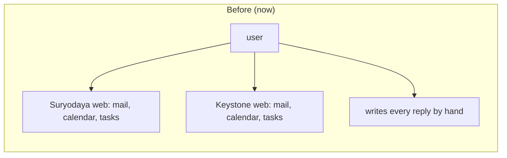
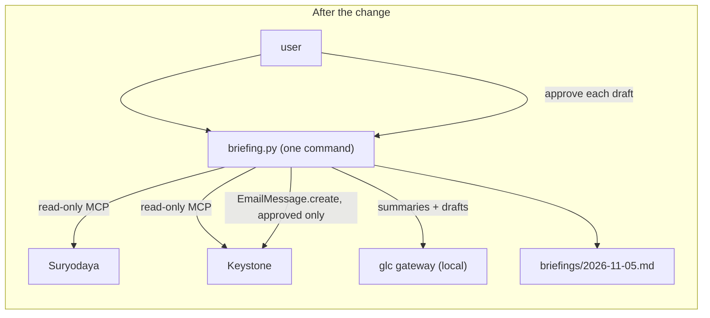
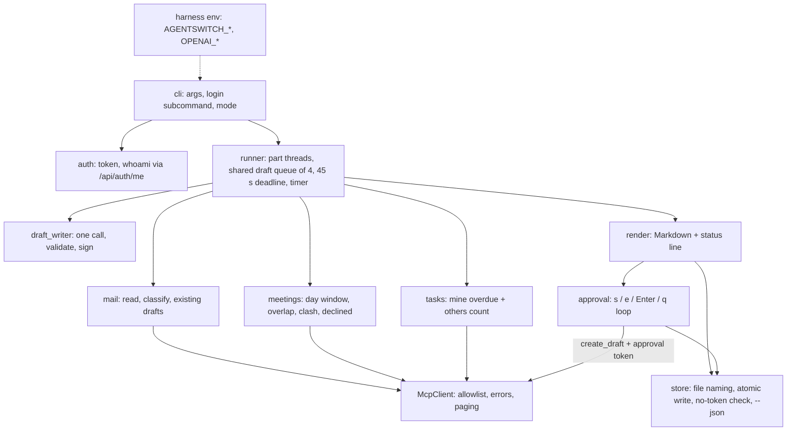
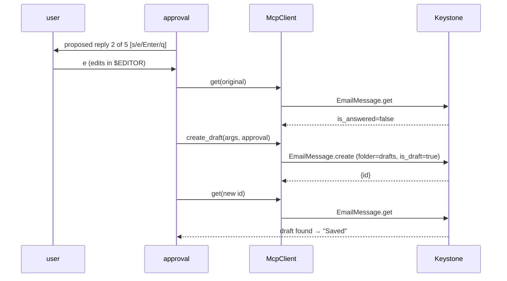

# Solution Design: Seat 28 EA — Daily Briefing (Sandip)

**Date:** 2026-11-05
**Artifact:** solution-design
**Status:** Approved
**Template version:** default/0.3.2
**PRD:** [prd.md](prd.md)
**References:** Seat brief `28-ea/README.md` and top-level `README.md` in github.com/theschoolofai/agentswitch-advanced; seat 33 MCP client `33-red-team/replay/mcp_client.py` (pattern); Varun's briefing, upstream PR #10 (comparison); Eval Harness task format `34-eval-harness/TASK_FORMAT.md`; read-only `tools/list` and sample `list` calls on Suryodaya and Keystone under `team28c`, 2026-11-05

**Plugin version:** 0.7.5
**Agent Sessions:** claude-code: a32408f5-6f38-4838-b910-c1af0931f2f1
**Self-review:** CAP_REACHED — round-2 findings fixed, not re-reviewed. Round-2 findings, verbatim in short: (1) the time limit and model failure left messages without the summary FR-012 requires, and the time limit weakens "Many messages", with no deviation recorded; (2) letting the model skip candidates (`expects_reply=false`) changes FR-010 and contradicts SD-D-7; (3) the "Summary in English" edge case wasn't covered; (4) unconfirmed whether `EmailMessage.get` marks mail read or a draft create sets `is_answered`; (5) the redraft's commitment content isn't checked, which contradicts the "property of the code" claim; (6) fetch time wasn't bounded, so the 60 s claim was too strong; (7) the token save-failure message differed from the PRD's; (8) unclear whether declined meetings can clash; (9) "12-task suite" wasn't defined.
**Self-review (harness revision, 2026-11-06):** CAP_REACHED — round-2 findings fixed, not re-reviewed. Round-2 findings, verbatim in short: (1) the 60 s MUST isn't guaranteed and isn't in Deviations; (2) a missing `AGENTSWITCH_BASE_URL` would point a harness token at live data; (3) scripted input could never save, which contradicts SD-D-18; (4) FR-013/FR-014 rest on the model, with no deviation, and SD-D-14 claimed "by construction"; (5) unclear which module calls `draft_writer`, and no runner module; (6) the drafting start and queue order were ambiguous; (7) the "rerun for more drafts" hint was false; (8) complete-versus-missing undefined for partial parts and a failed drafts-folder read; (9) `--system` conflicting with the instance, and `AGENTSWITCH_BASE_URL` set alone, were undefined.

---

> *Section audience —* 🔍 reviewer (understand the design without implementing it) · 🛠 author (implement the design). Sections without an icon serve both.

## Summary 🔍

The seat-28 user checks mail, meetings and tasks on two systems, in two time zones, and writes every reply by hand (PRD Overview). This design builds the PRD's briefing as one standard-library Python command in `28-ea/sandip/`. It reads both systems in parallel through the AgentSwitch MCP (Model Context Protocol) endpoint and prints one section per system. It saves a dated Markdown file and then offers each proposed reply for approval. A local LLM (large language model) gateway, glc, writes the summaries and replies. Deterministic rules choose which mail needs an answer, so the model never decides what is shown. A write guard inside the MCP client refuses every tool except a fixed list of the reads the briefing needs and one draft-creating call. That call needs an approval token that only the approval loop can issue. This makes "nothing is sent or changed without approval" (FR-050) a property of the code, not of prompts. The wording of each reply is still the model's, and you read it before saving. The same command also runs under the Eval Harness (seat 34). There it takes its token, system and model endpoint from the harness's environment variables, and with nobody at the keyboard every draft counts as skipped. It also writes a JSON result that harness verifiers can check.

## Background & problem 🔍

Today nothing in the repository serves the seat-28 user. Varun's version (PR #10) prints one fixed sentence as a "reply". It works in IST only, lists every visible overdue task (71 on Suryodaya, 63 on Keystone, none his) and saves nothing. The PRD asks for more: per-system days, the user's own tasks, real drafts with a per-draft approved save, and a briefing that survives one system or part failing.

Three platform facts shape the design. All were read on 2026-11-05 with read-only calls:

- Both systems expose the same 472 tools. Several of them write or send: `EmailMessage.reply` sends a reply ("mailbox, recipient, subject and threading are taken from the original"), and `EmailMessage.send_email` sends mail. `EmailMessage.save_draft` only re-saves an existing draft, so a new draft reply can only come from `EmailMessage.create`.
- `team28c` has no mailbox on either system yet (`EmailAccount.list` and `EmailMessage.list` both return 0). The Keystone sample mailbox is pending with the platform team.
- The platform has no text-generation tool, so summaries and replies need a model outside the platform.

## Goals and non-goals

### Goals

**G1: One briefing across both systems that survives partial failure** (realizes FR-001–FR-007)
- [ ] G1-AC1 — A full run prints a Suryodaya section and a Keystone section, each with Mail, Meetings and Tasks parts, then a status line naming each part as complete or missing and the elapsed seconds without approval time. A part is complete when its list was read in full. A part that shows a reason instead of its list counts as missing, and that includes "no mailbox for this login". Two partial cases still count as complete, with their note shown: Tasks when only the others count failed (G4-AC2), and Mail when single messages couldn't be opened (G2-AC6). Mail counts as missing when the drafts-folder read fails (Data flow, Mail step 3), because without it the briefing could propose a second draft · `verify: unit test with a fake MCP transport for both systems; manual live run`
- [ ] G1-AC2 — With one system's token rejected (HTTP 401), that system's three parts each show "Keystone: login expired — log in again" and the other system's parts are complete · `verify: unit test, fake transport returns 401 for Keystone`
- [ ] G1-AC3 — A failure in one part (tool error, timeout) shows that part's plain reason and the other two parts of that system are still shown · `verify: unit test, fake transport fails only CalendarEvent.list`
- [ ] G1-AC4 — `--system keystone` reads and shows only Keystone, its status line names only Keystone, and it saves `briefings/<date>-keystone.md`. `<date>.md` is left byte-identical · `verify: unit test on a temp briefing folder, file hash compared before/after`
- [ ] G1-AC5 — When every part on every requested system is missing (including "no mailbox"), no file is written, an existing file of that name is byte-identical afterwards, and the user sees "Nothing fetched — today's earlier briefing file kept" · `verify: unit test on a temp folder`
- [ ] G1-AC6 — A save failure never corrupts an earlier file. Files are written to a temporary file and renamed into place · `verify: unit test makes the folder read-only and checks the earlier file and the printed message`
- [ ] G1-AC7 — Progress lines ("Reading Keystone…", "Drafting replies (3 of 7)…") go to standard error, never into the briefing text or file · `verify: unit test captures stdout and stderr separately`

**G2: Mail that needs an answer, with safe proposed replies** (realizes FR-010–FR-014, FR-044)
- [ ] G2-AC1 — Only fixed rules decide which mail needs an answer, and they run before any model call. A message needs an answer only if it is in the inbox, unread, not a draft and not answered. Fixed header and address rules (Data flow, Mail step 5) move no-reply senders, automated mail, newsletters and the user's own mail under "Skipped — no reply expected", each with its reason. These rules are the working definition of FR-011's categories. The model never adds a message to the list or removes one · `verify: table-driven unit tests, one fixture per rule`
- [ ] G2-AC2 — Each message needing an answer is listed oldest first, with sender, subject, received time (in the system's zone), a one-line summary and a proposed reply. The reply is put together in code from the model's `greeting` and `body` fields plus the signature. It is accepted only if the greeting is not empty, the whole reply is at most 120 words, and the model's `reply_language` equals its `message_language`. The summary is accepted only if the model reports `summary_language` as English. Otherwise, and whenever no model result is available, the message shows its first sentence (taken from `snippet` or the body, cut to 25 words, in the message's own language) labelled "(no summary — first line shown)" instead of a summary (see Deviations, FR-012 summary). The signature is `BRIEFING_SIGNATURE` if set, otherwise the name the user gave at `login`, otherwise the `name` from `/api/auth/me`. A reply that fails any check is dropped, and the message shows "No draft for this message (…) — reply by hand" · `verify: unit tests with a fake draft writer returning valid, too-long, greeting-less and wrong-language replies`
- [ ] G2-AC3 — "needs your decision" is set when the model flags a commitment OR a keyword rule matches (date, time, payment, invoice, attend, meeting, confirm, deadline). The model can add the mark but never remove it. When the keyword rule marks a message the model did not flag, the model's reply is thrown away and requested once more with an explicit "do not agree to any date, amount or attendance; say the user will confirm" instruction. If that second reply also fails validation, the message shows "No draft for this message (needs your decision) — reply by hand" · `verify: unit test, model says false and keyword rule says true: mark shown and a second draft request carrying the instruction`
- [ ] G2-AC4 — A message that already has a draft reply created by this login (a draft whose `in_reply_to` is the message's `message_id` and whose `created_by` is the user's `id`) shows "draft already saved" with that draft's text, and no new reply is proposed for it · `verify: unit test; live check once the Keystone mailbox exists`
- [ ] G2-AC6 — Each candidate is read in full with `EmailMessage.get` before drafting. A failed read lists the message under "couldn't be opened" with "1 message couldn't be opened (subject: …) — skipped; open it in the mailbox, and report it if it repeats", and no draft is proposed for it · `verify: unit test, fake get fails for one message`
- [ ] G2-AC7 — A system's messages join the drafting queue as soon as that system's Mail part has been read, without waiting for Meetings or Tasks. The queue is shared by both systems and always takes the message with the oldest `received_at` next. Drafting has a deadline of 45 seconds from the start of the run. A message whose draft isn't ready by the deadline keeps its first line (G2-AC2) and shows "No draft for this message (time limit) — reply by hand". This bounds drafting whatever the number of messages (see Deviations, FR-012) · `verify: unit test with a fake clock and a slow fake draft writer`
- [ ] G2-AC5 — With no mailbox for the login, the Mail part shows "<System>: no mailbox for this login — ask the course team to set one up" and no model call is made for that system · `verify: unit test; live run today (both systems have no mailbox)`

**G3: Today's meetings in each system's own day** (realizes FR-020–FR-023)
- [ ] G3-AC1 — "Today" is the calendar day in the system's zone: Asia/Kolkata for Suryodaya and America/New_York for Keystone by default. `--tz keystone=<IANA zone>` changes one system's zone, and an unknown zone falls back to the default with a message · `verify: unit tests with a fixed clock, including the PRD's 22:00 US Eastern case`
- [ ] G3-AC2 — An event is listed when it overlaps that day: start before day end and end after day start, all-day events by date. Cancelled events (`status == "cancelled"`) are hidden. The list is all-day events first, then by start time. Each entry shows title, start and end time in and labelled with the system's zone (for example "09:00–09:30 IST"), and organiser (`organizer_email`, or "—" when empty) · `verify: unit tests, including midnight-spanning events`
- [ ] G3-AC3 — Overlapping timed meetings are both marked "clash". This includes declined meetings, following FR-023 literally. A meeting whose attendee entry for the user's email is `declined` is marked "declined". All-day events never clash · `verify: unit tests`
- [ ] G3-AC4 — The overlap filter always runs on the client. Server-side date filters only narrow the fetch, so a filter the server ignores cannot add or drop a meeting · `verify: unit test where the fake server ignores the filter and returns every event`

**G4: The user's own overdue tasks** (realizes FR-030, FR-031)
- [ ] G4-AC1 — A task is the user's when `created_by` equals the user's `id`, or `assignee_id` equals the user's `id` or `employee_id`. Both values come from `/api/auth/me` (SD-D-10). It is open when its `status` is not one of `done`, `completed`, `cancelled`, `canceled`, `closed`. It is overdue when its `due_date` (first 10 characters, `YYYY-MM-DD`) is before today's date in the system's zone. A task with no due date is never overdue. The user's own tasks are listed most overdue first, with title, due date and days overdue · `verify: unit tests with due today, done, no due date and other-user fixtures`
- [ ] G4-AC2 — The user's own list and the count of others come from separate reads (see Data flow), so one can fail without the other. If the own-list reads fail, the Tasks part is missing. If only the others read fails, the own list is shown and the count line reads "Count of other overdue tasks unavailable — your own list above is complete" · `verify: unit tests, own reads fail; others read fails on page 2 of 3`

**G5: Approved drafts only, never anything else** (realizes FR-040–FR-046, FR-050)
- [ ] G5-AC1 — The MCP client refuses, before any network call, every tool outside a fixed allowlist: the `list`/`get` reads used here plus `EmailMessage.create`. `EmailMessage.create` is accepted only with `folder="drafts"`, `is_draft=true` and an approval token that only the approval loop issues · `verify: unit test calls EmailMessage.reply, EmailMessage.send_email, Task.update and an unapproved create, and each raises with zero transport calls`
- [ ] G5-AC2 — With no proposed replies, the approval step prints "No drafts to approve" and ends. Otherwise each proposed reply is offered with `[s]ave / [e]dit then save / [Enter] skip / [q] stop`, and a save shows "Saving draft…" then "Saved" or the failure message before the next offer. Any other input, or Enter, counts as skip. "edit then save" opens the text in `$EDITOR` (falling back to `nano`, then to typed lines), and an empty result counts as skip · `verify: unit tests with scripted input and a fake editor`
- [ ] G5-AC3 — Just before saving, the original is re-read. If it is now answered the user sees "Already answered — draft not saved". After `create`, the new draft is read back. If that read fails the user sees "Draft may not be saved — check your Drafts folder" and nothing is retried · `verify: unit tests with a fake transport`
- [ ] G5-AC4 — The approval step ends with "N saved (M edited), N skipped, N not saved", where replies left after stop (including the one stop was chosen on) and failed saves count as not saved. The briefing file is rewritten with an Approval section that holds this summary and the approved text of every failed save · `verify: unit test for the PRD's Story 5 Scenario 4 numbers; file contents checked`
- [ ] G5-AC5 — Guardrail signal: a before/after snapshot of mail, events and tasks on both systems differs only by the drafts the user approved in that run · `verify: snapshot script run around each live test run; diff must be empty when everything is skipped`
- [ ] G5-AC6 — No token or model API key appears in stdout, stderr or any output file. The renderer never receives one, and as a second guard every output (screen, Markdown and JSON) replaces any loaded token or key that appears in content with `***` before it is written. The file is still saved · `verify: unit test plants the token in a fake message subject; screen and both files show *** and the file is saved`

**G6: Runs under the Eval Harness unchanged** (serves the 30 November test suite; `34-eval-harness/TASK_FORMAT.md`)
- [ ] G6-AC1 — Harness mode starts when `AGENTSWITCH_TOKEN` or `AGENTSWITCH_INSTANCE` is set. All three of `AGENTSWITCH_TOKEN`, `AGENTSWITCH_INSTANCE` and `AGENTSWITCH_BASE_URL` are then required, so a harness token can never reach the live system by default. Otherwise the run stops with exit code 2 and one plain line. The same happens for an instance other than `suryodaya` or `keystone`, or for a `--system` that names a different system. The run covers only that instance, at `AGENTSWITCH_BASE_URL`, and reads no login file. `AGENTSWITCH_BASE_URL` set on its own doesn't start harness mode and is ignored with a warning on standard error · `verify: unit tests for each combination with a fake transport; the transport sees only the given base URL`
- [ ] G6-AC2 — When `OPENAI_BASE_URL` is set, the model endpoint is `<OPENAI_BASE_URL>/chat/completions` with model `OPENAI_MODEL`, which is then required (exit code 2 if missing). The same applies to `BRIEFING_LLM_URL`. When `chat/completions` answers 404, the adapter uses glc's own `<url>/chat` for the rest of the run (edited 2026-11-06, plan deviation row 21). `OPENAI_API_KEY`, when set, is sent as `Authorization: Bearer …`. Without `OPENAI_BASE_URL`, the `BRIEFING_LLM_*` settings apply and any other `OPENAI_*` variable is ignored. With `BRIEFING_LLM_MODEL` unset, the briefing still runs (exit 0): standard error says "BRIEFING_LLM_MODEL not set — no drafts this run", no model call is made, and each message shows "(model unavailable)" with its first line (added 2026-11-06, plan slice 2 replan) · `verify: unit tests on the adapter's request for each combination`
- [ ] G6-AC3 — Choices are always read line by line from standard input. At end of file, every remaining offer reads as "no choice", which FR-040 defines as skip. When standard input is not a terminal, `e` (edit then save) also counts as skip because no editor can open, while `s`, Enter and `q` work as usual. So a run with standard input from `/dev/null` saves nothing and ends "0 saved (0 edited), N skipped, 0 not saved", and a scripted run can pipe in `s` to test a save. After a `/dev/null` run, the instance under test is unchanged. A harness verifier checks this on the copy before it is thrown away, and a local run checks it with the snapshot · `verify: unit tests with stdin at EOF (zero create calls) and with piped "s" and "e" (one create call, no editor); guardrail snapshot diff empty on a live harness-style run (env vars set, stdin from /dev/null)`
- [ ] G6-AC4 — `--json <path>` also writes the run's results as JSON:
  - per system and part, `complete` or the missing reason;
  - the ids shown: messages needing an answer, skipped messages with reasons, messages that couldn't be opened, "draft already saved" messages, events with clash/declined marks, own overdue tasks with days overdue, and the others count;
  - per message needing an answer, a draft status: `proposed`, `model_unavailable`, `time_limit`, `invalid` or `needs_decision_redraft_failed`;
  - a `model` block with calls made, failures and `unreachable` (true when a connection failed);
  - the approval summary.

  A harness runner can compare these against the database without reading Markdown, and can report a model outage as an infrastructure failure · `verify: unit test checks the JSON against the same fixtures as the Markdown, including a model outage`
- [ ] G6-AC5 — Exit codes: 0 when the briefing ran, even with missing parts; 1 when nothing could be fetched (FR-007's case); 2 for a usage or configuration error. A harness runner can tell "couldn't run" from "ran with gaps" · `verify: unit tests for each code`

### Non-goals

- Template-written replies. If the model is unavailable, a message gets no draft and reads "reply by hand". A template mode is built only if the admin/PM rules out the model (see Key facts).
- Retrying failed calls, caching between runs, or any background process.
- Rich terminal UI, colours, or a web or chat front end (PRD-D-17).
- Sharing code with Nishanth's or Varun's folders. The 30 November merge decides the shared base.
- Scheduled runs, meeting replies, task changes and Drive content (PRD Out of Scope).
- The harness suite itself: `agentswitch-harness.toml`, a harness runner, `results.json` and the 12 tasks with their verifiers. These are version 1 work for 30 November and build on G6.

## Architecture

The briefing is a single command, `python3 28-ea/sandip/briefing.py`, built from small modules in the package `28-ea/sandip/ea_briefing/`. It uses only the standard library (Python 3.9+, for `zoneinfo`), the same as the seat 33 client.

A run has five stages:

1. **Setup.** The `cli` module parses `--system`, `--tz system=zone`, `--json <path>` and the `login` subcommand. `config` decides the mode: in harness mode (G6-AC1) the system, address and token come from the `AGENTSWITCH_*` variables. Otherwise `auth` loads each requested system's token from `AGENTSWITCH_<SYSTEM>_TOKEN` or the login file. For each system, `auth.whoami` then calls `/api/auth/me` to get the user's `id`, `employee_id`, `email` and `name`. A missing token, or a 401 from `/api/auth/me`, makes all three parts of that system fail with "log in again". If `/api/auth/me` can't be reached or times out, all three parts show "<System>: can't be reached right now — try again later". Any other error makes them show "<System>: couldn't be read (reason: …) — report it if it repeats", because every part needs the identity. This call is part of the system's fetch and counts in the run time. Nothing else stops the run.
2. **Fetch, in parallel.** The `runner` starts one thread per part per system, up to six, each with its own `McpClient` for that system. The parts are `mail`, `meetings` and `tasks`. Each reader returns a `PartResult`: either the data or a failure with a plain reason. Readers never raise past this boundary, which is how partial failure (PRD-D-10) holds. The mail reader only reads and classifies. It does no drafting.
3. **Draft.** As soon as a system's Mail part is read, the `runner` adds its "needs an answer" messages to one queue shared by both systems, oldest first. The runner's pool calls `draft_writer` for at most 4 messages at a time in total, and stops at the 45-second drafting deadline (G2-AC7). Drafting overlaps with Meetings and Tasks reads still running.
4. **Render and save.** `render` turns the results into one Markdown text: sections, parts, and the status line with elapsed time. That text is both printed (stdout) and handed to `store`, which applies the file rules (FR-005, FR-007) and writes the file atomically.
5. **Approve.** `approval` offers the proposed replies one at a time, or prints "No drafts to approve" when there are none. Choices are read from standard input, with the end-of-file and no-terminal rules of G6-AC3. A save goes through `McpClient.create_draft`, the only write path. Afterwards `store` rewrites the same file with the Approval section added, and writes the `--json` file if one was asked for.

`McpClient` is the safety boundary. It holds the per-system base URL and token, maps transport errors to typed failures (`LoginExpired` for 401, `Unreachable` for connection errors and timeouts, `ToolFailed(reason)` for MCP errors and `isError` replies), paginates `list` calls, and enforces the write allowlist (G5-AC1). It is the only code that calls the platform's `/api/mcp` endpoint. The only other platform calls are in `auth`: `login` posts to `/api/auth/login`, and `whoami` reads `/api/auth/me`. Neither changes a record.

`draft_writer` is the model boundary. It has one function, `write(message, user) -> Draft | DraftFailed`, behind an HTTP adapter. The adapter speaks OpenAI-compatible `chat/completions` first; on a 404 it switches to glc's own `POST /v1/chat` (`{model, system, messages, max_tokens, temperature}`, answering `{text}`), and it retries a 429 or 503 within the deadline (edited 2026-11-06, plan deviation rows 21–22). Its endpoint is the harness's `OPENAI_BASE_URL`, `OPENAI_MODEL` and `OPENAI_API_KEY` when set, otherwise the glc gateway (`BRIEFING_LLM_URL`, default `http://127.0.0.1:8111/v1`, and `BRIEFING_LLM_MODEL`). It asks for JSON (`summary`, `summary_language`, `needs_decision`, `message_language`, `reply_language`, `greeting`, `body`), then puts the reply together and checks it in code (G2-AC2, G2-AC3). A 15-second timeout applies to each call, and drafting stops at the run's 45-second drafting deadline (G2-AC7). The mail body is passed as quoted data with an instruction to ignore instructions inside it. Even if a message manipulates the model, the worst outcome is a bad proposal that the user sees and can skip.

## Components

All paths are under `28-ea/sandip/`.

- **`briefing.py`** — Entry point. Calls `ea_briefing.cli.main()`.
- **`ea_briefing/cli.py`** — Argument parsing (`--system`, `--tz`, `--json`, `login <system>`), wiring, and exit codes (G6-AC5).
- **`ea_briefing/config.py`** — System table (name, base URL, default zone), harness-mode detection and checks (G6-AC1, G6-AC2), and environment settings. In harness mode it uses `AGENTSWITCH_TOKEN`/`AGENTSWITCH_INSTANCE`/`AGENTSWITCH_BASE_URL`, otherwise `AGENTSWITCH_<SYSTEM>_TOKEN` and the system table. For the model it uses `OPENAI_*` when `OPENAI_BASE_URL` is set, otherwise `BRIEFING_LLM_URL`/`BRIEFING_LLM_MODEL`. It also reads `BRIEFING_SIGNATURE` and `BRIEFING_DIR`, and parses zones with fallback.
- **`ea_briefing/runner.py`** — The run's timer, the part threads (one per part per system), the shared drafting queue (oldest `received_at` first, at most 4 calls at a time, 45-second deadline) and collecting the `PartResult`s.
- **`ea_briefing/auth.py`** — `login`: asks for the password with `getpass` and for the name to sign replies with (the first time only), calls `/api/auth/login`, and stores `{token, signature}` in `~/.config/agentswitch/<system>.json` with mode 0600. The password is never stored. `load`: the token from the harness variable, `AGENTSWITCH_<SYSTEM>_TOKEN` or the file, in that order. `whoami`: reads `/api/auth/me` for `id`, `employee_id`, `email` and `name`.
- **`ea_briefing/mcp.py`** — `McpClient`: JSON-RPC `tools/call` over `urllib`, JSON or event-stream replies, typed errors, `list_all` paging, the read allowlist, and `create_draft(args, approval)`.
- **`ea_briefing/mail.py`** — Mailbox check (`Mailbox.list`, `EmailAccount.list`), unread inbox fetch, existing-draft lookup, skip rules and full reads. Returns a `MailPart` whose "needs an answer" messages the runner queues for drafting.
- **`ea_briefing/draft_writer.py`** — Prompt, glc adapter, response validation, keyword decision rule and signature. Returns `Draft` or `DraftFailed(reason)`.
- **`ea_briefing/meetings.py`** — Day window per zone, event fetch, overlap, all-day ordering, clash and declined marks. Returns a `MeetingsPart`.
- **`ea_briefing/tasks.py`** — Overdue fetch, own/others split, days overdue and the others count. Returns a `TasksPart`.
- **`ea_briefing/render.py`** — Pure functions from part results to Markdown text and the status line, and to the `--json` result (G6-AC4). No I/O.
- **`ea_briefing/store.py`** — File name rule, nothing-fetched rule, no-token check, and atomic write (temporary file plus `os.replace`) for the Markdown file and the JSON file.
- **`ea_briefing/approval.py`** — Interactive loop reading choices line by line from standard input (end of file = skip, `e` without a terminal = skip, G6-AC3), editor handling, re-check before save, read-back after save, and the summary counts.
- **`tools/snapshot.py`** — Guardrail helper: writes a JSON list of ids and `updated_at` for mail, events and tasks per system to a git-ignored folder, and diffs two snapshots.
- **`tests/`** — `unittest` suites per module, a `FakeTransport` that records every call, and fixtures. No network.
- **`.gitignore`** — `briefings/`, `snapshots/`, `__pycache__/`.
- **`README.md`** — Setup (`login`), running, settings, harness mode (variables, `--json`, exit codes), tests, and the safety rules in one paragraph.

## Data flow

**Mail on one system**

1. `Mailbox.list` and `EmailAccount.list`. If both are empty → "no mailbox" and stop the Mail part.
2. `EmailMessage.list(folder="inbox", is_read=false, is_draft=false)`, all pages, answered or not.
3. `EmailMessage.list(folder="drafts")`, all pages. A draft with `created_by` equal to the user's `id` and `in_reply_to` equal to an inbox row's `message_id` means "draft already saved" for that row (FR-044), whether or not the row is now answered. Those rows leave the remaining steps and are shown with the draft's text. Matching happens on the client, so it doesn't depend on whether the server supports an `in_reply_to` filter.
4. Drop rows with `is_answered` true.
5. Apply the skip rules in order. The first match gives the reason:
   - sent by you: the sender is the mailbox address;
   - no-reply sender: the address matches `no-?reply|do-?not-?reply|mailer-daemon|notifications?@`;
   - newsletter: `list_unsubscribe` is set or `split_category == "news"`;
   - automated notification: `raw_headers` contains `Auto-Submitted:` (any value except `no`) or `Precedence: bulk|list|junk`.
6. `EmailMessage.get` for each remaining message, for the full body (G2-AC6).
7. The rest are queued for `draft_writer`, oldest first by `received_at` (Architecture, stage 3). Results are attached per message.

**Tasks on one system**

1. Own tasks: `Task.list(assignee_id=<id>, …)`, `Task.list(assignee_id=<employee_id>, …)` (skipped when there is no `employee_id`) and `Task.list(created_by=<id>, …)`, each with `due_date="lt:<today>"` and all pages, merged by `id`. Then the client applies the open and overdue checks from G4-AC1.
2. Others: `Task.list(due_date="lt:<today>")`, all pages. Apply the same checks on the client and count the rows whose `id` is not in the own list.

**A harness run**

The harness sets `AGENTSWITCH_BASE_URL`, `AGENTSWITCH_TOKEN`, `AGENTSWITCH_INSTANCE` and `OPENAI_*`, and a future runner calls `python3 briefing.py --json <run dir>/briefing.json < /dev/null`. The briefing reads one instance (a copy of the live data), drafts through the harness's model endpoint, and skips every draft because standard input is at end of file. A save-test task can instead pipe `s` lines into the command. It then writes `briefings/<date>-<instance>.md` plus the JSON file and exits 0, 1 or 2. The runner (a non-goal here) turns the JSON and its own database checks into `results.json`. A task such as "mail that needs no reply gets no draft" is judged on the database: no draft exists afterwards.

**Saving one approved draft**

`EmailMessage.get(original)` → if answered, stop. Otherwise `EmailMessage.create`. The arguments are copied from the original: `company_id`, `mailbox_id` and `thread_id`, with `from_email` set to the mailbox address, `to` to the original sender, `subject` to "Re: …" unless it already starts with "Re:", `in_reply_to` to the original `message_id`, and `references` to the original's references plus that id. The body is `body_text` = the approved text, with `folder="drafts"`, `is_draft=true` and `is_read=true`. Then `EmailMessage.get(new id)` confirms the save.

## Error handling

The PRD's error tables fix the user messages. The design adds these behaviours:

- **Login expired during approval.** `LoginExpired` from any approval call stops that system's offers ("Keystone: login expired — remaining drafts not saved; log in again and rerun"). The rest count as not saved, and the other system's drafts are still offered.
- **Model unreachable or slow.** A timeout (15 seconds per call), a connection error or invalid JSON gives that message `DraftFailed`. The message stays listed with its first line (G2-AC2) and "No draft for this message (model unavailable) — reply by hand". If a call fails to connect, the rest of that run skips the model. The 45-second drafting deadline (G2-AC7) bounds slow-but-connected calls.
- **Slow platform.** Each platform request has a 15-second timeout. A request that times out fails its part with the PRD's "can't be reached" or "couldn't be read" message. There is no cut-off on the whole fetch, so long lists are always shown in full (PRD-D-14). A slow platform shows up as a longer time in the status line rather than as missing data.
- **Ctrl-C during approval.** Treated as stop. The summary and file rewrite still happen.
- **Editor missing or failing.** Falls back to typed lines ending with an empty line.
- **Token in content.** If a loaded token or API key appears in content, it is replaced by `***` on screen and in both files, which are still saved (G5-AC6). This meets the PRD's non-functional rule without dropping the file (FR-005, FR-046).

## Testing & verification

- **Unit tests** (`python3 -m unittest discover -s 28-ea/sandip/tests -t 28-ea/sandip`, with `tests/__init__.py`) cover every acceptance criterion above against `FakeTransport` and a fake draft writer, with a fixed clock. They run offline in a few seconds.
- **PRD scenario map.** Every PRD acceptance scenario gets one named unit test, `test_story<N>_scenario<M>_*`. When the version 1 harness suite of 12 tasks (due 30 November) is written, each of its database-checked tasks names the scenario it covers, so the two can be traced to each other. The unit tests themselves don't run in the harness. Story 5 scenarios and Story 2's mail scenarios also get a live run once the Keystone sample mailbox exists. Until then they pass on fakes only, and the success metric counts them as not yet in scope, as the PRD allows.
- **Live smoke run** on both systems today. It covers meetings and tasks on test data created under `team28c` (a test meeting for today, a task due today, checked again the next day), and the "no mailbox" path.
- **Guardrail run.** `tools/snapshot.py before` → briefing, skipping everything → `tools/snapshot.py after` → the diff must be empty. Repeat with one approved save, where the diff must be exactly one new draft.
- **Timing.** The status-line seconds of three live full runs are recorded in the README and must stay under 60.
- **Harness-style run.** One live run per system with the harness variables set by hand (own token, own instance, `OPENAI_*` pointing at glc) and standard input from `/dev/null`. The snapshot diff must be empty, the JSON file must parse and match the Markdown, and the exit code must be 0.

## Decisions 🔍

| ID | Title | Context | Options | Choice | Rationale | Source | Goal impact | Consequences |
|----|-------|---------|---------|--------|-----------|--------|-------------|--------------|
| SD-D-1 | Who writes summaries and replies | No text-generation tool on the platform; FR-013/FR-014 need language and intent | Fixed templates; Claude API from the script; Claude Code session writes them; local glc gateway | Local glc gateway at `http://127.0.0.1:8111/` | User's choice; keeps a plain terminal command (PRD-D-17) | user | G2-AC2, G2-AC3 | Mail content goes to the gateway; whether a model may be used at all is an open question to the admin/PM (Key facts) |
| SD-D-2 | Gateway API format | glc's API was not reachable from the design session | OpenAI-compatible; Anthropic Messages; one adapter, configurable | One adapter in `draft_writer`, OpenAI-compatible by default, URL and model from environment | User's choice; the guess is confined to one file | user | G2-AC2 | Confirmed by the slice 2 probe, 2026-11-06: glc is not OpenAI-compatible (`/v1/chat/completions` answers 404). The adapter tries `chat/completions` first, for the harness gateway, then glc's own `/v1/chat` (plan deviation row 21) |
| SD-D-3 | Token handling | Tokens last 7 days; nothing secret may reach the public repo | Env vars only; `login` subcommand with token file outside repo; password in env, login every run | `briefing.py login <system>`: hidden password prompt, token and signature name in `~/.config/agentswitch/<system>.json` (0600); env var overrides | User's choice; "log in again" points at one command; logins per run would spend tries against the 10-try lockout | user | G1-AC2, G5-AC6 | The harness token (G6-AC1) takes precedence over both |
| SD-D-4 | Editing a reply | FR-040 "edit then save" in a terminal | Type a new reply; open in `$EDITOR`; regenerate with hint | `$EDITOR`, then `nano`, then typed lines; empty result = skip | User's choice; small fixes without retyping; empty-file rule matches PRD "empty edit" | user | G5-AC2 | None |
| SD-D-5 | Write guard in the client | 472 tools include `EmailMessage.reply` and `send_email`, which send | Rely on code review; allowlist in client; separate read and write clients | Allowlist in `McpClient`; `create` only for drafts with an approval token | Makes FR-050 testable without a network: a forbidden call fails before any request | auto (tools/list, PRD FR-050) | G5-AC1 | Adding a tool later means editing the allowlist on purpose |
| SD-D-6 | How a draft reply is created | `save_draft` re-saves an existing draft only; `reply` sends | `EmailMessage.reply`; `EmailMessage.create` as a draft; `create` then `save_draft` | `EmailMessage.create` with `folder=drafts`, `is_draft=true`, threading fields copied from the original | Only path that creates an unsent draft (tool descriptions, 2026-11-05) | auto (tools/list) | G5-AC3 | Field set unverified until a mailbox exists; Nishanth saw created messages unreadable without a mailbox, so read-back is required |
| SD-D-7 | Who decides which mail needs an answer | Model or rules could classify | Model; rules; both | Fixed rules on headers and flags, before any model call | Deterministic and testable (PRD-D-3); a model cannot hide mail or invent skip reasons | auto (PRD-D-3, FR-011) | G2-AC1 | The rules are the working definition of FR-011's categories; automated mail they miss is a defect to fix in the rules, not accepted behaviour |
| SD-D-8 | Commitment flag | FR-014 must hold even if the model misjudges | Model only; keyword rule only; either | Mark when model OR keyword rule says so; when only the rule fires, redraft once with an explicit non-committal instruction | The mark is the user's safety net, and the redraft lowers the chance that a marked reply carries a commitment the model missed. Reply content is not checked by code: FR-014 rests on the model following the instruction plus the user reading every draft before saving it (Key facts) | auto (PRD FR-014) | G2-AC3 | Some "needs your decision" marks will be unnecessary; a redraft costs one extra model call |
| SD-D-9 | Meeting window filtering | Server date-filter semantics are unverified; Suryodaya shows 593 events | Trust server filter; client filter only; both | Server filters narrow the fetch with date-only bounds (`start_at lt:<day+2>`, `end_at gte:<day-1>`); the client overlap check decides. Edited 2026-11-06 after the slice 1 probe: the server compares stored text, so instant bounds such as `lt:<day end UTC>` dropped real events (plan deviation row 11) | Correctness doesn't depend on unverified filter syntax; Varun's `between:` on `start_at` misses events from yesterday | auto (Varun PR #10, tools/list) | G3-AC4 | If the server ignores filters, a run pages through all events (slower, still correct) |
| SD-D-10 | Identity of "me" | Tasks and attendee status need the user, and a harness run has only a token | Search tasks by name; ids stored at login; `/api/auth/me` on every run | `/api/auth/me` at the start of every run: `id`, `employee_id`, `email`, `name` | Works with a token alone (observed on Keystone, 2026-11-06), so local and harness runs behave the same; `employee_id` covers an `assignee_id` that holds the employee rather than the user | auto (`/api/auth/me` reply) | G3-AC3, G4-AC1, G6-AC1 | One extra read per system per run; which id `assignee_id` holds is checked in the first slice with an own test task. Probed 2026-11-06: it holds an Employee id, and `employee_id` is null for `team28c` |
| SD-D-11 | Briefing folder and repository | Files hold mail content and the repository is public | Commit briefings; git-ignore them | `28-ea/sandip/briefings/`, git-ignored; `BRIEFING_DIR` overrides | Top-level README rules 3 and 5: no private data in the public repository | auto (top-level README) | G1-AC4–AC6 | Demo evidence is shown from screen or a redacted copy |
| SD-D-12 | File date and write method | Two systems have different "todays"; a failed write must not damage the earlier file | Per-system date; machine-local date; atomic or direct write | Machine-local date for the file name, also for a one-system run; temporary file plus `os.replace` | FR-005's "its date" is read as the date of the run on the user's own machine. That date is the user's day, and it keeps one file per day as PRD-D-16 describes. Atomic replace protects FR-007's "earlier file unchanged" | auto (PRD FR-005, FR-007) | G1-AC4–AC6 | A Keystone-only run at 08:00 IST is filed under the IST date, while its section header shows Keystone's own date |
| SD-D-13 | Meeting the 60-second budget | Two systems, many pages, one model call per message | Sequential; thread per system; plus parallel model calls | One thread per part per system for platform reads (15 s timeout per request, no cut-off on the whole fetch); one drafting queue shared by both systems that starts as soon as a Mail part is read, at most 4 model calls at a time, 15 s per call, model skipped after a connection failure, deadline 45 s from run start | Drafting is the part that grows with the inbox, so the deadline bounds it; reads run in parallel to keep them short, and aren't cut off because PRD-D-14 says long lists are shown in full. The status line reports the actual time (PRD success metric) | auto (PRD NFR, PRD-D-14) | G1-AC1, G2-AC7 | Gateway load of at most 4 parallel calls; up to 6 concurrent platform readers; a very slow platform can push a run past 60 s (Deviations, NFR 60 s); fewer drafts on a long inbox (Deviations, FR-012) |
| SD-D-14 | Model output handling | Model text can be too long, unsigned, or manipulated by mail content | Use as is; validate and finish in code | Code checks word count and greeting, appends signature, drops invalid replies as "reply by hand" | Length, greeting and signature hold by construction. The language rule rests on the model's own language labels, and the user reviews every draft (Deviations, FR-013/FR-014) | auto (PRD FR-013) | G2-AC2 | Some messages get no draft when the model misbehaves |
| SD-D-15 | Re-check before saving | A message may be answered after the briefing (FR-045) | Trust briefing data; re-read | `EmailMessage.get` before each save; read-back after save; no automatic retry | Prevents duplicate and stale drafts as the PRD's error table asks | auto (PRD FR-045, Story 5 errors) | G5-AC3 | Two extra reads per saved draft |
| SD-D-17 | Harness compatibility in this design | The seat's 30 Nov version 1 runs under the Eval Harness (top-level README; `34-eval-harness/TASK_FORMAT.md`) | Leave to the plan; defer to 30 Nov; add now as a goal | Add G6 now: harness variables, `OPENAI_*` model endpoint, non-terminal skip, `--json`, exit codes; runner and 12 tasks stay out | User's choice; these change how the briefing is configured and run, and are cheaper before the 15 Nov comparison than after | user | G6 | Small extra surface for the first task; the harness suite builds on it later |
| SD-D-18 | Approval without a person | The harness runs with no terminal; FR-040 says no choice counts as skip | Refuse to run; auto-approve; treat each offer as no choice | Choices are read line by line from standard input. End of file reads as no choice, which is skip, and `e` without a terminal is skip | Uses FR-040's own default, so no deviation. A `/dev/null` harness run can never write, and a scripted run can still test a save by piping `s` | auto (PRD FR-040, TASK_FORMAT "refusal tasks") | G6-AC3 | "Edit then save" can't be tested through the harness; it stays a unit-test and manual check |
| SD-D-19 | Machine-readable result and exit codes | Harness verifiers judge data, not wording, and must tell infrastructure failure from gaps | Parse the Markdown; `--json` file; JSON to stdout | `--json <path>` alongside the Markdown; exit 0 / 1 / 2 | Keeps stdout the readable briefing; a stable JSON seam for the future runner | auto (TASK_FORMAT §3) | G6-AC4, G6-AC5 | The JSON shape becomes a contract the version 1 suite depends on |
| SD-D-16 | Code layout | Seat plan keeps each member's code apart | Single script like Varun's; small package | `28-ea/sandip/briefing.py` plus `ea_briefing/` modules, standard library only | Nishanth's Stage 1 plan (`28-ea/sandip/`); modules small enough to test alone; matches seat 33's stdlib rule | auto (seat chat, seat 33 README) | all | Python 3.9+ required |

## Deviations from PRD 🔍

| ID | Type | Status | PRD updated? | Note |
|----|------|--------|--------------|------|
| FR-012 | change | approved | yes — PRD Story 2 Edge Cases "Many messages" and Error Handling "A proposed reply can't be written" edited 2026-11-05 | Story 2's "Many messages" edge case says every message gets its own proposed reply. To keep the 60-second NFR, drafting stops 45 s into the run (G2-AC7, SD-D-13). On a long inbox, the newest messages are listed with their first line and "No draft for this message (time limit) — reply by hand". (The earlier hint "rerun with `--system <name>` for more drafts" was dropped on 2026-11-06: a rerun drafts the same oldest messages first, so the hint wasn't true. The PRD row is edited to match.) The PRD's "A proposed reply can't be written" row already allows a message without a draft. This row makes the time limit an explicit reason for it. |
| FR-012 (summary) | change | approved | yes — PRD Story 2 Edge Cases "Non-English mail" and Error Handling "A proposed reply can't be written" edited 2026-11-06 | FR-012 and Story 2 require a one-line summary, in English, for every message needing an answer, and the "reply can't be written" error row assumes a summary is still there. The summary comes from the same model call as the draft. So when the model is unavailable, past the drafting deadline, or returns a non-English summary, the message shows its first sentence in its own language, labelled "(no summary — first line shown)" (G2-AC2). Writing a real summary without a model isn't possible. |
| NFR (60 seconds) | change | approved | yes — PRD Non-Functional Requirements, 60-second line, edited 2026-11-06 | The PRD says a full two-system briefing "must finish in under 60 seconds". The design bounds drafting (45 s deadline) and runs all reads in parallel, but doesn't cut off platform reads, because PRD-D-14 says long lists are shown in full. A very slow platform can therefore push a run past 60 s. The status line shows the real time, and the timing check in Testing measures it. Proposed reading: under 60 s when the platform answers in its usual time. |
| FR-013 / FR-014 | change | approved | yes — PRD Functional Requirements, note under FR-014 added 2026-11-06 | FR-013 (reply in the message's language) and FR-014 (never commit to a date, money or attendance) are MUSTs. Code enforces length, greeting and signature, the "needs your decision" mark and one non-committal redraft. Whether the reply really is in the right language and really commits to nothing rests on the model (its language labels, its following the instruction) plus the user reading every draft before saving. No code check can prove it. |

## Key facts & assumptions

**The rule to remember:** the only write the briefing can make is `EmailMessage.create` of a draft, through `McpClient.create_draft`, with an approval token from the approval loop. Every other write or send tool is refused in code. The code guarantees what the briefing does to records. It does not guarantee what a proposed reply says: FR-014's "never commit" rests on the model instruction and the redraft (SD-D-8), and on the user reading each draft before choosing save.

**Open question for the admin / product manager (non-blocking for v1 meetings and tasks):** may the seat-28 agent use a language model (the local glc gateway) to summarise mail and draft replies, and may mail content be sent to it? If the answer is no, replies fall back to fixed templates. That fallback would fail FR-013 (reply in the message's language) and needs a PRD change and a design revision before Story 2 ships. Until the answer comes, the model path is built and a failed model call gives "reply by hand".

**Unconfirmed assumptions, each checked in the first plan slice:**
- ~~glc exposes an OpenAI-compatible `/v1/chat/completions` (SD-D-2).~~ Refuted 2026-11-06: glc exposes only its own `POST /v1/chat`, drops `system`-role messages (the prompt goes in its `system` field), and answers 503 to calls in quick succession (plan deviation rows 21–22).
- `list` filters take the `lt:` / `gt:` / `gte:` prefix form, as Varun's code uses on `due_date` (SD-D-9). Probed 2026-11-06: the server compares the stored text, so event bounds are date-only. Timed events are stored as naive local wall-clock time in the row's `timezone` (else the system's zone) or with an explicit offset, never as UTC. All-day rows are date-only with an exclusive end, and the flag is the boolean `all_day`. Correctness does not depend on the filters.
- Task `created_by` holds the user's `id`, and `assignee_id` holds either the `id` or the `employee_id` (SD-D-10). Today neither filter returns a task for `team28c`, because no own tasks exist yet. The own-task reads in Data flow query `assignee_id` with both values.
- `/api/auth/me` answers the same way on Suryodaya as on Keystone. It was checked on Keystone only.
- In harness mode, `OPENAI_BASE_URL` is a base URL to which `/chat/completions` is appended, as with the OpenAI client libraries. The harness copy of the instance carries the same tools and fields as the live one.
- Event `attendees` (embedded in `CalendarEvent.list` rows) carry `email` and `status` the way `EventAttendee` does. If not, `EventAttendee.list(event_id=…)` is read per event.
- `EmailMessage.get` does not mark a message as read, and `EmailMessage.create` of a draft does not change the original message. If either does, the run changes records (FR-050). The guardrail snapshot (G5-AC5) detects both on the first live mail run, and the design then needs revising before Story 2 ships.
- `EmailMessage` rows carry `created_by` (the creating user's id) and `in_reply_to`, as the `EmailMessage.list` input schema lists. The draft lookup (Data flow, Mail step 3) depends on both.
- `CalendarEvent.list` returns the events visible to the login, including ones the user doesn't attend. The design lists them as FR-020 states. If live runs show other people's events, raise it in review before v1.
- The `EmailMessage.create` field set in Data flow creates an unsent, threaded draft. Verified only once the Keystone sample mailbox exists. Story 5 ships only after that (PRD-D-12).
